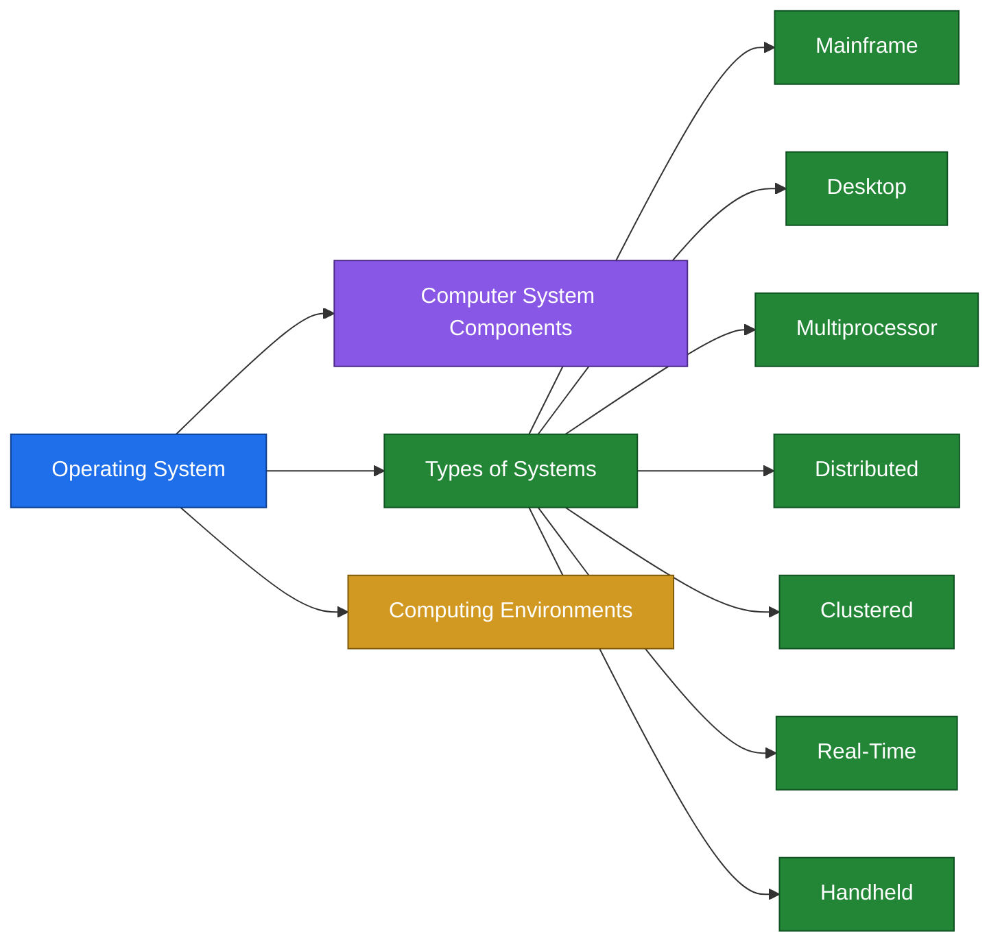
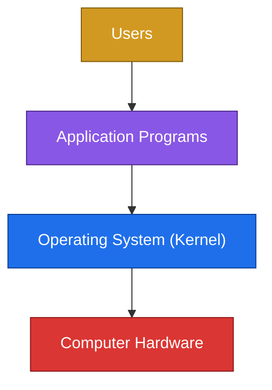
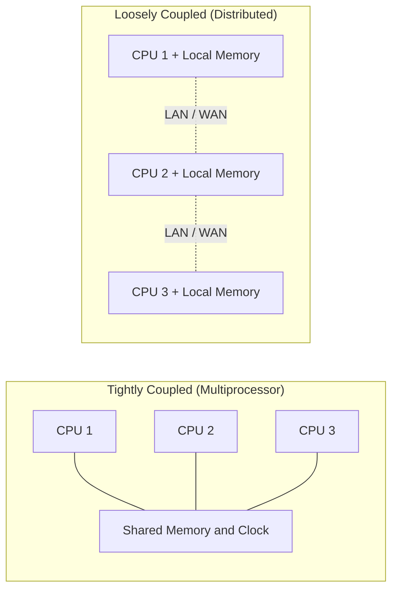
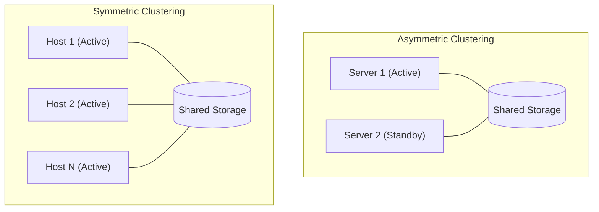

# 01-Introduction

## 1. Overview

الشابتر ده هو بداية الكورس. بيشرح يعني إيه Operating System، والكمبيوتر متكون من إيه، وأنواع الأنظمة المختلفة من أول الـ Mainframe لحد الـ Handheld.

| Topic | بيتكلم عن إيه |
|---|---|
| Operating System | التعريف والأهداف |
| Computer System Components | الأربع مكونات الأساسية للجهاز |
| Mainframe Systems | أقدم أنواع الأنظمة وتطورها |
| Desktop Systems | الأجهزة الشخصية |
| Multiprocessor Systems | أكتر من CPU في نفس الجهاز |
| Distributed Systems | توزيع الشغل على أجهزة كتير |
| Clustered Systems | أجهزة بتشارك storage للـ reliability |
| Real-Time Systems | أنظمة ليها وقت محدد لازم تخلص فيه |
| Handheld Systems | الموبايل والأجهزة الصغيرة |
| Computing Environments | Traditional و Web-Based و Embedded |



> [!CAUTION]
> ملحوظة: الـ slides فيها Self Study Topics وهي Virtual Memory و File-System Interface و File-System Implementation. دي مش داخلة في الشابتر ده.

---

## 2. Key Concepts

| Term | Definition | الشرح |
|---|---|---|
| Operating System | An intermediary between a user and the hardware | برنامج وسيط بين المستخدم والجهاز |
| Kernel | The one program running at all times | البرنامج الوحيد اللي شغال طول وقت تشغيل الجهاز |
| Hardware | CPU, memory and I/O devices | الأجزاء الفعلية للجهاز |
| Application Programs | Compilers, web browsers, spreadsheets, word processors | البرامج اللي المستخدم بيشتغل عليها |
| User | People, machines or other computers | المستخدم مش شرط يكون إنسان |
| Batch | Grouping similar jobs and running them one after another | تجميع الـ jobs المتشابهة عشان نوفر وقت التجهيز |
| Multiprogramming | Several jobs kept in main memory at the same time | أكتر من job في الـ memory والـ CPU بيتنقل بينهم |
| Time-Sharing | Interactive computing, jobs swapped between memory and disk | نفس الفكرة بس المستخدم بيتفاعل مع الجهاز مباشرة |
| Multiprocessor | More than one CPU in close communication | أكتر من CPU في نفس النظام |
| Tightly Coupled | Processors share memory and a clock | الـ processors بتتشارك الـ memory |
| Loosely Coupled | Each processor has its own local memory | كل processor ليه memory خاصة بيه |
| Cluster | Two or more systems sharing storage | أجهزة بتتشارك storage عشان نزود الـ reliability |
| Real-Time | A system with well-defined fixed-time constraints | نظام ليه وقت محدد لازم يخلص فيه |
| Embedded | Very limited OS features, little or no user interface | نظام بسيط جوه جهاز متخصص |

---

## 3. Detailed Explanation

### 3.1 Operating System

- It acts as an intermediary between a user and the hardware.
- Objectives of the operating system:
  - Executes users programs.
  - Solves users problems.
  - Uses the hardware in an efficient manner.
  - Makes the user life easier.

الـ Operating System بيقف في النص بين المستخدم والجهاز. المستخدم بيطلب والـ OS هو اللي بينفذ ويوزع الـ resources على البرامج.

### 3.2 Computer System Components

| Component | Description |
|---|---|
| Computer Hardware | The physical resources: CPU, memory, I/O devices |
| Operating System | Controls and coordinates the use of the hardware among the application programs and users. Manages and allocates resources. Controls the execution of user programs and the operation of I/O devices. |
| Application Programs | Compilers, web browsers, spreadsheets, word processors |
| Users | People, machines, other computers |

> [!CAUTION]
> ملحوظة: الـ Kernel هو البرنامج الوحيد اللي شغال طول الوقت، وده جزء من تعريف الـ OS.

### 3.3 Mainframe Systems

- Reduce setup time by batching similar jobs.
- Automatic job sequencing: control is transferred automatically from one job to another.
- High reliability and massive I/O throughput.
- Used in banking, airlines and healthcare.

الـ Mainframe اتطور على ثلاث مراحل.

**Simple Batch Systems**

- Similar jobs are grouped into one batch to reduce setup time.
- The memory holds the operating system and one user program.

الـ jobs المتشابهة بتتجمع وتتشغل ورا بعض. بكده منضيعش وقت في تجهيز كل job لوحده، والـ OS بينقل التحكم من job للي بعده من غير تدخل.

**Multi-programmed Batch Systems**

- Several jobs are kept in main memory at the same time.
- The CPU is multiplexed among them.

لما job يستنى الـ I/O، الـ CPU بيروح لـ job تاني بدل ما يفضل فاضي.

**Time-Sharing Systems (Interactive Computing)**

- The CPU is multiplexed among several jobs kept in memory and on disk.
- The CPU is allocated to a job only if the job is in memory.
- A job is swapped in and out of memory to the disk.
- On-line communication between the user and the system is provided.
- When the OS finishes the execution of one command, it seeks the next control statement from the user's keyboard.

نفس فكرة الـ multiprogramming، لكن المستخدم قاعد على الجهاز وبيتفاعل معاه مباشرة.

> [!CAUTION]
> ملحوظة: الـ Batch مفيهوش تفاعل مع المستخدم، والـ Time-Sharing فيه تفاعل.

### 3.4 Desktop Systems

- Personal computers: a computer system dedicated to a single user.
- I/O devices: keyboards, mice, display screens, small printers.
- Focus on user convenience and responsiveness.
- Can adopt technology developed for larger operating systems.
- Individuals often have sole use of the computer, so they do not need advanced CPU utilization or protection features.
- May run several types of operating systems: Windows, MacOS, UNIX, Linux.

### 3.5 Multiprocessor Systems (Parallel Systems)

- Systems with more than one CPU in close communication.
- Tightly coupled system: processors share memory and a clock.
- Communication usually takes place through the shared memory.

| Advantage | Meaning |
|---|---|
| Increased throughput | More work done in less time |
| Economical | Cheaper than several separate systems |
| Increased reliability | The system keeps working if one processor fails |

### 3.6 Distributed Systems

- Distribute the computation among several physical processors.
- Loosely coupled system: each processor has its own local memory.
- Processors communicate through communication lines such as high-speed buses or telephone lines.
- Requires networking infrastructure: LAN or WAN.
- May be either client-server or peer-to-peer.

| Advantage | Meaning |
|---|---|
| Resources sharing | Devices and data are shared between sites |
| Computation speed up | The work is split to finish faster |
| Load sharing | The work is spread between the processors |
| Reliability | A failure in one site does not stop everything |

### 3.7 Clustered Systems

- Clustering allows two or more systems to share storage.
- Provides high reliability.

| Type | Description |
|---|---|
| Asymmetric clustering | One server runs the application while the other servers stand by |
| Symmetric clustering | All N hosts are running the application |

### 3.8 Real-Time Systems

- Often used as a control device in a dedicated application: scientific experiments, medical imaging systems, industrial control systems, some display systems.
- Well-defined fixed-time constraints.
- May be either hard or soft real-time.

| | Hard Real-Time | Soft Real-Time |
|---|---|---|
| Storage | Secondary storage limited or absent. Data stored in short-term memory or ROM | Normal |
| Time-sharing | Conflicts with time-sharing | Can be integrated with time-sharing |
| General-purpose OS | Not supported | Supported |
| Use | Strict control applications | Multimedia, virtual reality |

الفرق إن الـ Hard مينفعش يتأخر خالص، والـ Soft ممكن يتأخر شوية والجودة بس هي اللي تقل.

### 3.9 Handheld Systems

- Personal Digital Assistants (PDAs).
- Cellular phones and smart phones.
- Issues: limited memory, slow processors, small display screens.

### 3.10 Computing Environments

| Environment | Description |
|---|---|
| Traditional computing | PCs and servers, limited remote access |
| Web-Based computing | Client-server and web services, convenient remote access, location-less servers |
| Embedded computing | Very limited operating system features, little or no user interface, remote access |

---

## 4. Examples and Diagrams

### Computer System Layers



### Simple Batch vs Multiprogramming

```
Simple Batch

Memory :  [ OS ][ Job 1 ]
CPU    :  | Job 1 runs | idle, waiting for I/O | Job 1 runs |


Multiprogramming

Memory :  [ OS ][ Job 1 ][ Job 2 ][ Job 3 ]
CPU    :  | Job 1 | Job 2 | Job 3 | Job 1 | Job 2 |
          (when Job 1 waits for I/O, the CPU switches to Job 2)
```

### Tightly Coupled vs Loosely Coupled



### Clustering



### Examples

| System | Example |
|---|---|
| Mainframe | Bank and airline systems |
| Desktop | A personal laptop |
| Multiprocessor | A multi-core CPU working on one shared RAM |
| Distributed | A large website running on servers in different locations |
| Clustered | Two servers where the second takes over if the first fails |
| Hard Real-Time | A car airbag controller |
| Soft Real-Time | Video streaming |
| Embedded | A microwave or a washing machine |
| Handheld | A smart phone |

---

## 5. Important Comparisons

### Batch vs Multiprogrammed vs Time-Sharing

| | Simple Batch | Multiprogrammed Batch | Time-Sharing |
|---|---|---|---|
| Jobs in memory | One | Several | Several (memory and disk, with swapping) |
| User interaction | No | No | Yes, on-line |
| Goal | Reduce setup time | Keep the CPU busy during I/O | Fast response to the user |
| CPU during I/O wait | Idle | Switches to another job | Switches to another job |

### Multiprocessor vs Distributed

| | Multiprocessor (Parallel) | Distributed |
|---|---|---|
| Coupling | Tightly coupled | Loosely coupled |
| Memory | Shared | Local to each processor |
| Clock | Shared | Not shared |
| Communication | Through shared memory | Through communication lines |
| Needs a network | No | Yes (LAN or WAN) |
| Advantages | Throughput, economical, reliability | Resource sharing, speed up, load sharing, reliability |

### Asymmetric vs Symmetric Clustering

| | Asymmetric | Symmetric |
|---|---|---|
| Running the application | One server only | All N hosts |
| Other servers | Standby | Active |

### Hard vs Soft Real-Time

| | Hard Real-Time | Soft Real-Time |
|---|---|---|
| Secondary storage | Limited or absent | Normal |
| With time-sharing | Conflicts | Can be integrated |
| General-purpose OS | Not supported | Supported |
| Typical use | Strict control applications | Multimedia, virtual reality |

### Computing Environments

| | Traditional | Web-Based | Embedded |
|---|---|---|---|
| Systems | PCs, servers | Client-server, web services | Dedicated devices |
| Remote access | Limited | Convenient | Yes |
| User interface | Normal | Normal | Little or none |
| OS features | Full | Full | Very limited |

---

## 6. Quick Revision

| Term | In one line |
|---|---|
| Operating System | Intermediary between the user and the hardware |
| Kernel | The one program running at all times |
| Batch | Similar jobs grouped together to reduce setup time |
| Multiprogramming | Several jobs in memory, the CPU is never idle |
| Time-Sharing | Multiprogramming with interactive user communication |
| Multiprocessor | Tightly coupled, shared memory and clock |
| Distributed | Loosely coupled, local memory, needs a network |
| Cluster | Systems sharing storage for high reliability |
| Real-Time | Fixed-time constraints, either hard or soft |

| Topic | Count | Items |
|---|:---:|---|
| Computer system components | 4 | Hardware, OS, Application Programs, Users |
| Multiprocessor advantages | 3 | Throughput, Economical, Reliability |
| Distributed advantages | 4 | Resources sharing, Computation speed up, Load sharing, Reliability |
| Clustering types | 2 | Asymmetric, Symmetric |
| Real-Time types | 2 | Hard, Soft |
| Handheld issues | 3 | Limited memory, Slow processors, Small display screens |
| Computing environments | 3 | Traditional, Web-Based, Embedded |

**Interview answer: What is an Operating System?**

An operating system is software that acts as an intermediary between the user and the hardware. It manages resources such as the CPU, memory and I/O devices, executes user programs, and makes the use of the hardware efficient and easy. The kernel is the part that runs at all times.

---

## 7. Questions to Test Myself

### Multiple Choice

**Q1. Which of the following is the kernel?**

- A. Any application running on the machine
- B. The one program running at all times ✔
- C. The physical hardware
- D. A program that runs only at boot time

**Q2. What does time-sharing add compared to multiprogrammed batch?**

- A. Several jobs in memory
- B. On-line communication between the user and the system ✔
- C. A CPU that is never idle
- D. More expensive hardware

**Q3. In which system do the processors share memory and a clock?**

- A. Distributed system
- B. Loosely coupled system
- C. Tightly coupled system ✔
- D. Handheld system

**Q4. What happens in asymmetric clustering?**

- A. All hosts run the application
- B. One server runs the application while the others stand by ✔
- C. There is no shared storage
- D. The servers do not communicate

**Q5. Which type of real-time system is not supported by general-purpose operating systems?**

- A. Soft real-time
- B. Hard real-time ✔
- C. Both
- D. Neither

### True / False

1. Application programs are part of the operating system.
   **False.** They are a separate component.
2. A user can be a machine or another computer.
   **True.**
3. Distributed systems require networking infrastructure.
   **True.** LAN or WAN.
4. In a simple batch system the CPU runs several jobs at the same time.
   **False.** That is multiprogramming.
5. Handheld systems suffer from limited memory and slow processors.
   **True.**

### Essay Questions

**Q6. What is an operating system, and what are its objectives?**

It is an intermediary between the user and the hardware. Its objectives are to execute user programs, solve user problems, use the hardware efficiently, and make the user's life easier.

**Q7. What are the four components of a computer system?**

Computer hardware, operating system, application programs, and users.

**Q8. What is the difference between simple batch and multiprogrammed batch systems?**

In simple batch only one job is in memory, so the CPU stays idle during I/O. In multiprogrammed batch several jobs are in memory and the CPU switches between them, so it is not left idle.

**Q9. List the advantages of multiprocessor systems.**

Increased throughput, economical, and increased reliability.

**Q10. Compare tightly coupled and loosely coupled systems.**

Tightly coupled: processors share memory and a clock and communicate through the shared memory (multiprocessor). Loosely coupled: each processor has its own local memory and they communicate through communication lines (distributed).

**Q11. Differentiate between hard and soft real-time systems.**

Hard real-time has limited or no secondary storage, uses ROM or short-term memory, conflicts with time-sharing, and is not supported by general-purpose operating systems. Soft real-time can be integrated with time-sharing and is useful in multimedia and virtual reality.

**Q12. What is the difference between asymmetric and symmetric clustering?**

In asymmetric clustering one server runs the application while the others stand by. In symmetric clustering all N hosts run the application.

**Q13. List the computing environments and describe each briefly.**

Traditional: PCs and servers with limited remote access. Web-Based: client-server and web services with convenient remote access. Embedded: very limited operating system features with little or no user interface.
