# 02-Computer-System-Structure

## 1. Overview

الشابتر ده بيشرح الجهاز من جوه. إزاي الـ CPU والـ devices بيتكلموا مع بعض، وإزاي الجهاز بيبدأ شغل، وإزاي الـ OS بيعرف إن device خلّص شغله، وبعدين الـ storage وأنواعه، وآخر حاجة إزاي الـ hardware بيحمي النظام من الأخطاء.

| Topic | بيتكلم عن إيه |
|---|---|
| Computer System Operation | الـ buses والـ controllers وبداية التشغيل والـ interrupts |
| I/O Structure | الـ controllers وطرق الـ I/O والـ DMA |
| Storage Structure | الـ main memory والـ secondary storage والـ hierarchy |
| Hardware Protection | التعامل مع الأخطاء وحماية البرامج من بعض |

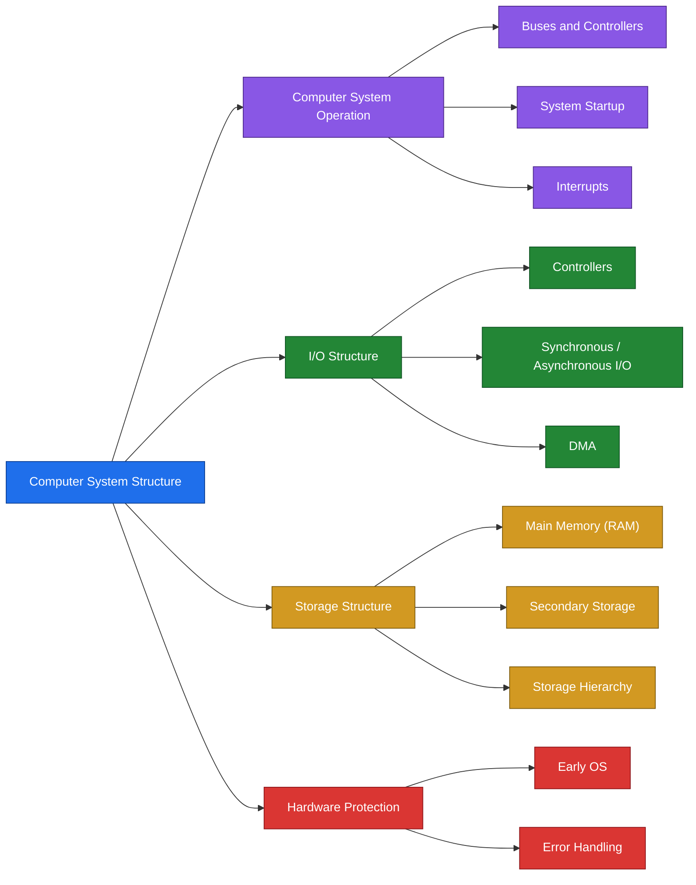

> [!CAUTION]
> ملحوظة: الـ slides مفيهاش شرح لـ dual-mode أو memory protection بالتفصيل. قسم الـ Hardware Protection فيها بيتكلم عن الأخطاء ومعالجتها بس.

---

## 2. Key Concepts

### Computer System Operation

| Term | Definition | الشرح |
|---|---|---|
| Bus | Common path connecting the CPU and device controllers: data, address and control | الخطوط اللي بتوصل الـ CPU بالـ controllers |
| Device Controller | In charge of a particular device type | مسؤول عن نوع واحد من الـ devices |
| Local Buffer | Storage inside each device controller | مكان تخزين مؤقت جوه الـ controller |
| Memory Controller | Synchronizes access to memory | بينظم الوصول للـ memory |
| Bootstrap | The initial program, stored in ROM | أول برنامج بيشتغل لما الجهاز يفتح |
| ROM | Read-only memory that stores the bootstrap | ذاكرة قراءة فقط |
| init | The first process started by the kernel | أول process بيبدأها الـ kernel |
| Interrupt | A signal sent to the CPU | إشارة للـ CPU عشان يوقف اللي بيعمله |
| Interrupt Service Routine | The code executed when an interrupt occurs | الكود اللي بيتنفذ لما interrupt يحصل |
| Interrupt Vector | Table containing the addresses of all the service routines | جدول فيه عناوين كل الـ routines |
| Trap | A software generated interrupt caused by an error or a request | interrupt بيتعمل من البرنامج |
| System Call | A software interrupt, a request from a user program to the OS | طلب من البرنامج للـ OS |

### I/O Structure

| Term | Definition | الشرح |
|---|---|---|
| Synchronous I/O | Control returns to the user process after the I/O is complete | البرنامج بيستنى لحد ما الـ I/O يخلص |
| Asynchronous I/O | Control returns immediately to the user process | البرنامج بيكمل شغل ومبيستناش |
| DMA | Device controller transfers blocks of data directly to main memory without CPU intervention | الـ controller بينقل الداتا للـ memory من غير ما الـ CPU يشارك |

### Storage Structure

| Term | Definition | الشرح |
|---|---|---|
| Main Memory | The only large storage media that the CPU can access directly | الـ CPU بيوصل ليها مباشرة |
| Secondary Storage | Extension of main memory with large nonvolatile capacity | تخزين دائم وكبير |
| Nonvolatile | Data is kept when the power is off | الداتا مبتضيعش لما الكهربا تفصل |
| RAM | Array of memory words, each byte has an address | مصفوفة من الـ words، كل byte ليه address |
| Load | Moves a word from main memory to a CPU register | نقل من الـ memory للـ register |
| Store | Moves a word from a CPU register to main memory | نقل من الـ register للـ memory |
| Track | A circle on the disk surface | دايرة على سطح الـ disk |
| Sector | A subdivision of a track | جزء من الـ track |
| Magnetic Tape | Early secondary storage with slow access time | وسيط تخزين قديم وبطيء |

### Hardware Protection

| Term | Definition | الشرح |
|---|---|---|
| Illegal instruction | An error detected by the hardware | أمر غير مسموح بتنفيذه |
| Infinite loop | A program that never ends | برنامج مبيخلصش |
| Memory access violation | Access of other memory addresses | محاولة الوصول لعناوين مش بتاعة البرنامج |

---

## 3. Detailed Explanation

### 3.1 Computer System Operation

- The CPU and the device controllers are connected through common buses: data, address and control.
- The CPU and the device controllers execute concurrently.
- The memory controller synchronizes access to memory.

الـ CPU والـ controllers بيشتغلوا في نفس الوقت، فمحتاجين حد ينظم الوصول للـ memory عشان محدش يتخبط في التاني، ودي وظيفة الـ memory controller.

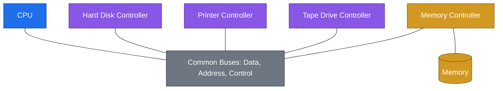

**Device controllers**

- Each device controller is in charge of a particular device type.
- Each device controller has a local buffer.
- The CPU moves data from and to main memory to and from the local buffers.
- The device controller informs the CPU that it has finished its operation by causing an interrupt.

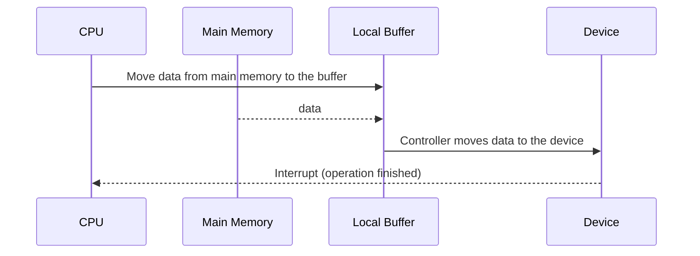

**Computer System Startup**

1. Power up.
2. The initial program, the bootstrap, runs. It is stored in ROM.
3. It initializes the CPU registers, the device controllers and the memory contents.
4. It loads the operating system (the kernel).
5. The kernel starts the first process, init.
6. init waits for an event (an interrupt) to occur.


الجهاز لما يفتح، أول حاجة بتشتغل هي الـ bootstrap لأنه متخزن في ROM. هو اللي بيجهز الـ hardware وبعدين بيحمّل الـ kernel، والـ kernel بيشغل init وده بيفضل مستني أي event.

**Interrupts**

- An interrupt is a signal sent to the CPU.
- It transfers control to the interrupt service routine, generally through the interrupt vector, which contains the addresses of all the service routines.
- Types: hardware interrupts, and software interrupts (system calls).
- A trap is a software generated interrupt caused by:
  - Error: division by zero or invalid memory access.
  - Request: from a user program to the OS.
- An operating system is interrupt driven.

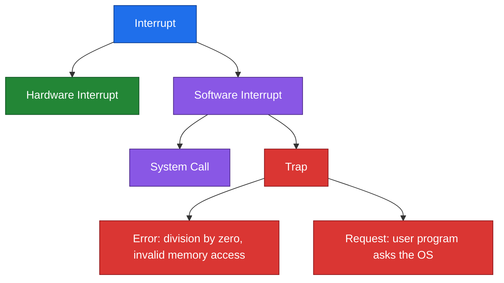

> [!CAUTION]
> ملحوظة: الـ OS هو نظام interrupt driven، يعني ساكت مستني لحد ما interrupt يحصل وساعتها يتحرك.

**Interrupt Handling**

1. The CPU is interrupted.
2. The CPU stops the current process.
3. The CPU transfers execution to a fixed location.
4. The CPU executes the interrupt service routine.
5. The CPU resumes the process.

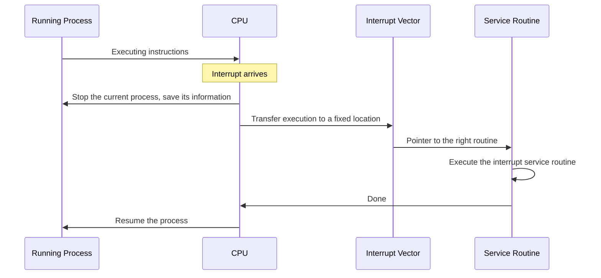

> [!CAUTION]
> ملحوظة: لازم الـ interrupt يتعالج بسرعة، ولازم معلومات الـ process اللي اتقطعت تتخزن عشان نرجعلها بعد كده.

**Interrupt Handling Mechanisms**

- Generic: examine the interrupt information and call the specific routine.
- Interrupt vector: a table of pointers to interrupt routines for the various devices. Applied in Unix and DOS.

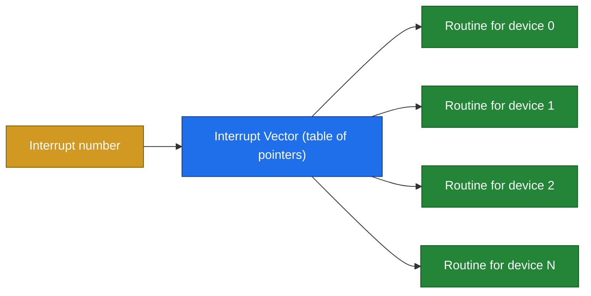

### 3.2 I/O Structure

**Controllers**

- A controller is in charge of a specific type of device.
- It moves data between the device and its local buffer.
- A controller may have more than one device.
- The buffer size varies.

**Two I/O methods**

| | Synchronous I/O | Asynchronous I/O |
|---|---|---|
| Step 1 | The process requests an I/O operation | The process requests an I/O operation |
| Step 2 | The I/O operation is started | The I/O operation is started |
| Step 3 | The I/O operation is completed | Control is returned immediately to the user process |
| Step 4 | Control is returned to the user process | The I/O continues while system operations occur |
| Example in the slides | Printer | None |

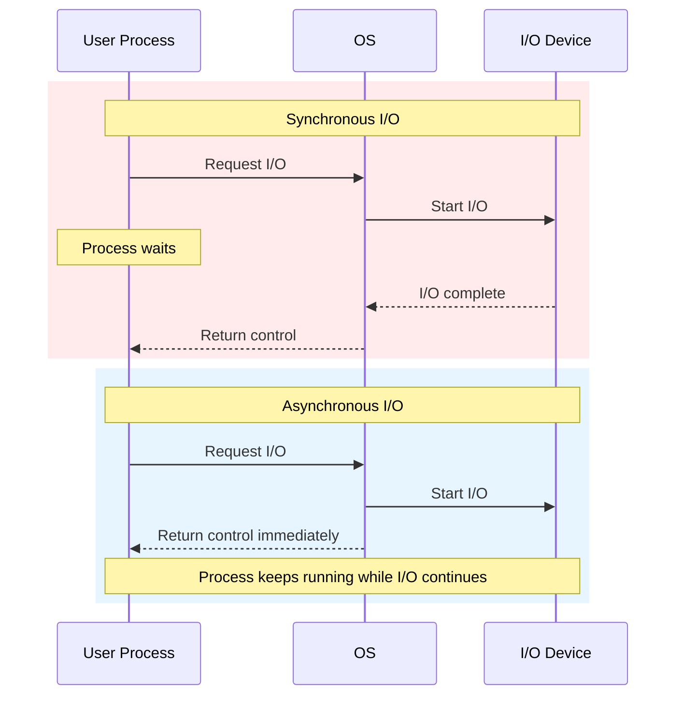

الفرق ببساطة إن الـ synchronous البرنامج بيقف لحد ما الـ I/O يخلص، والـ asynchronous البرنامج بيكمل شغله والـ I/O بيكمل جنبه.

**Direct Memory Access (DMA)**

- Used for high-speed I/O devices able to transmit information at close to memory speeds.
- The device controller transfers blocks of data from buffer storage directly to main memory without CPU intervention.
- Only one interrupt is generated per block, rather than one interrupt per byte.

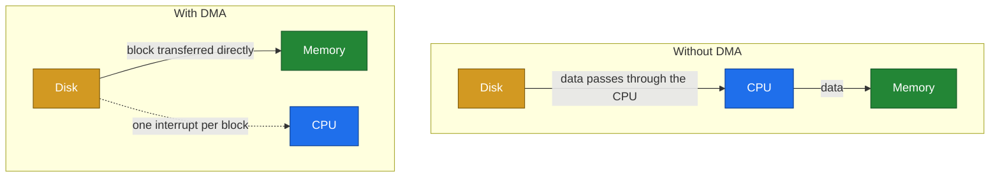

> [!CAUTION]
> ملحوظة: مع الـ DMA الـ CPU بيتقاطع مرة واحدة لكل block مش مرة لكل byte، وده بيوفر وقت كبير.

### 3.3 Storage Structure

- Main memory: the only large storage media that the CPU can access directly.
- Secondary storage: an extension of main memory that provides large nonvolatile storage capacity.

**Storage-Device Hierarchy**

الترتيب ده من تحت لفوق حسب الـ diagram اللي في الـ slides.

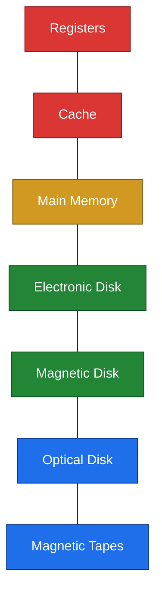

```
        Faster, more expensive, smaller
                     ^
                     |
              +-------------+
              |  Registers  |
              +-------------+
              |    Cache    |
              +-------------+
              | Main Memory |
              +-------------+
              |  Electronic |
              |    Disk     |
              +-------------+
              |  Magnetic   |
              |    Disk     |
              +-------------+
              |   Optical   |
              |    Disk     |
              +-------------+
              |  Magnetic   |
              |   Tapes     |
              +-------------+
                     |
                     v
        Slower, cheaper, larger
```

Storage devices are compared by: speed, cost, capacity, volatility, reliability and portability.

> [!CAUTION]
> ملحوظة: كل ما نزلنا في الـ hierarchy الـ devices بتبقى أبطأ وأرخص وأكبر في السعة، وكل ما طلعنا بتبقى أسرع وأغلى وأصغر. الـ slides بتذكر معايير المقارنة وبتوريك الترتيب في الرسمة.

**RAM**

- An array of memory words. Each byte has an address.
- Memory address: physical or logical.
- CPU instructions:
  - Load: moves a word from main memory to a CPU register.
  - Store: moves a word from a CPU register to main memory.


**Magnetic Disk**

- Rigid metal or glass platters covered with magnetic recording material.
- The disk surface is logically divided into tracks, which are subdivided into sectors.
- The disk controller determines the logical interaction between the device and the computer.

الرسمة في الـ slides بتوضح الأجزاء دي: spindle في النص، والـ platters متركبة عليه، وكل platter عليه tracks مقسمة لـ sectors، والـ arm assembly شايل arms وعلى طرف كل arm فيه read-write head. والـ cylinder هو نفس الـ track على كل الـ platters.

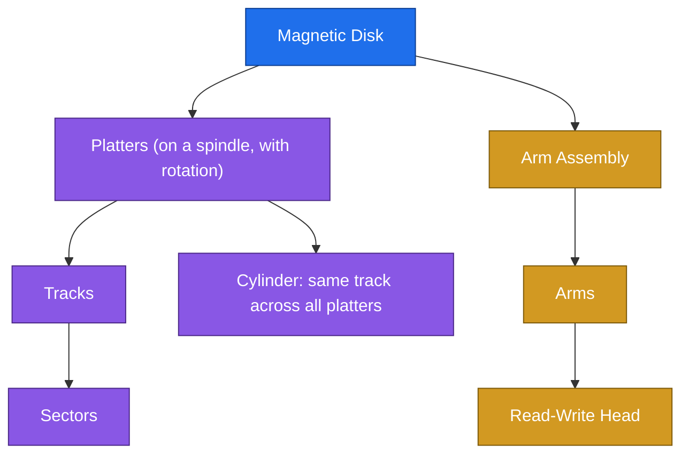

**Magnetic Tapes**

- Early secondary storage.
- Slow access time.
- Usage: backup, and storage of infrequently used information.

### 3.4 Hardware Protection

**Early operating systems**

- Single user.
- The programmer had full control of the hardware.
- The programmer was responsible for I/O.
- An error in a program:
  - Single task: only one program is affected.
  - Multi task: could cause problems to other programs.
- Desktop operating systems allow a program to access any part of memory or affect other programs' instructions or data.

**Error handling**

- Errors: illegal instruction, infinite loop, access of other memory addresses.
- The errors are detected by the hardware.
- The hardware traps the error to the OS.
- The errors are handled by the OS.
- The OS terminates the process and dumps the process to disk, if needed.

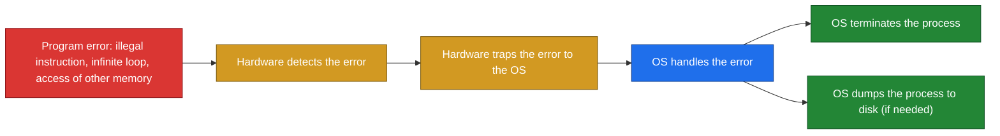

لما برنامج يغلط، الـ hardware هو اللي يكتشف الغلط وبعدين يديه للـ OS عن طريق trap. والـ OS هو اللي بيقرر يقفل الـ process وممكن يحفظ حالتها على الـ disk.

> [!CAUTION]
> ملحوظة: الـ trap هو الرابط بين القسمين. الـ hardware بيكتشف الخطأ والـ OS بيعالجه.

---

## 4. Examples and Diagrams

### The Big Picture

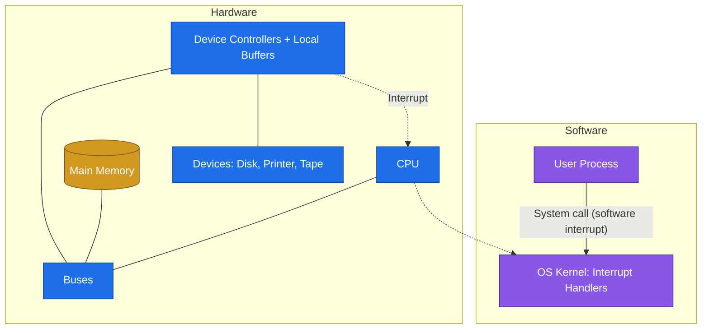

### Examples

| Concept | Example |
|---|---|
| Hardware interrupt | A device controller signals that its operation has finished |
| Software interrupt (system call) | A program asks the OS to read a file |
| Trap caused by an error | Division by zero |
| Trap caused by a request | A user program requests a service from the OS |
| Synchronous I/O | Printing, the program waits until the operation completes (the slides' example) |
| Asynchronous I/O | Starting a disk read and continuing to run other work |
| DMA | A disk transferring a large block straight to memory |
| Magnetic tape | Backups of data |
| Error handled by the OS | An infinite loop, where the OS terminates the process |

---

## 5. Important Comparisons

### Hardware Interrupt vs Software Interrupt

| | Hardware Interrupt | Software Interrupt |
|---|---|---|
| Source | A device (for example a controller finishing its work) | A program |
| Forms | Device signals | System calls, traps |
| Result | Control goes to the interrupt service routine | Control goes to the interrupt service routine |

### Interrupt vs Trap

| | Interrupt | Trap |
|---|---|---|
| Definition | A signal sent to the CPU | A software generated interrupt |
| Caused by | Hardware or software | An error or a request |
| Examples | Device finished its operation | Division by zero, invalid memory access, request to the OS |

### Generic vs Interrupt Vector

| | Generic | Interrupt Vector |
|---|---|---|
| How it works | Examines the interrupt information and calls the specific routine | Looks up a table of pointers to the routines |
| Applied in | Not specified in the slides | Unix and DOS |

### Synchronous vs Asynchronous I/O

| | Synchronous | Asynchronous |
|---|---|---|
| Control returns | After the I/O completes | Immediately |
| User process | Waits | Continues running |
| I/O during execution | Not running in parallel | Continues while system operations occur |

### With DMA vs Without DMA

| | Without DMA | With DMA |
|---|---|---|
| CPU involvement | The CPU takes part in the transfer | No CPU intervention in the transfer |
| Interrupts | Per byte | One per block |
| Used for | Normal I/O | High-speed I/O devices |

### Main Memory vs Secondary Storage

| | Main Memory | Secondary Storage |
|---|---|---|
| CPU access | Direct | Not direct |
| Capacity | Large | Large (extension of main memory) |
| Volatility | Volatile | Nonvolatile |
| Examples | RAM | Magnetic disk, magnetic tape, optical disk |

### Magnetic Disk vs Magnetic Tape

| | Magnetic Disk | Magnetic Tape |
|---|---|---|
| Role | Secondary storage | Early secondary storage |
| Access time | Faster | Slow |
| Usage | General secondary storage | Backup and infrequently used information |

### Early OS vs Multi-task / Desktop OS (Protection)

| | Early OS | Multi-task / Desktop OS |
|---|---|---|
| Users | Single user | Several programs can run |
| Hardware control | The programmer has full control | A program may access any part of memory |
| I/O | The programmer is responsible | Not described in the slides |
| Effect of a program error | Only that program is affected | Could cause problems to other programs |

---

## 6. Quick Revision

| Term | In one line |
|---|---|
| Bus | Common path between the CPU and the controllers: data, address, control |
| Device controller | In charge of one device type, has a local buffer |
| Memory controller | Synchronizes access to memory |
| Bootstrap | First program, stored in ROM, loads the kernel |
| init | First process started by the kernel |
| Interrupt | A signal sent to the CPU |
| Interrupt vector | Table with the addresses of all service routines |
| Trap | Software generated interrupt from an error or a request |
| Synchronous I/O | Control returns after completion |
| Asynchronous I/O | Control returns immediately |
| DMA | Controller moves blocks to memory without the CPU, one interrupt per block |
| Main memory | The only large storage the CPU accesses directly |
| Secondary storage | Large nonvolatile extension of main memory |
| Load / Store | Memory to register / register to memory |
| Error handling | Hardware detects, traps to the OS, OS handles |

| Topic | Count | Items |
|---|:---:|---|
| Types of buses | 3 | Data, Address, Control |
| Interrupt handling steps | 5 | Interrupted, stop process, transfer, execute ISR, resume |
| Types of interrupts | 2 | Hardware, Software |
| Causes of a trap | 2 | Error, Request |
| I/O methods | 2 | Synchronous, Asynchronous |
| Differences between storage devices | 6 | Speed, Cost, Capacity, Volatility, Reliability, Portability |
| Disk organization | 2 | Tracks, Sectors |
| Errors in the slides | 3 | Illegal instruction, Infinite loop, Access of other memory addresses |

**Startup order:** Power up, bootstrap from ROM, initialize registers and controllers and memory, load the kernel, start init, wait for an interrupt.

**Storage hierarchy, top to bottom:** Registers, Cache, Main Memory, Electronic Disk, Magnetic Disk, Optical Disk, Magnetic Tapes.

**Interview answer: What is an interrupt and how does the OS handle it?**

An interrupt is a signal sent to the CPU, either by hardware or by software. When it arrives, the CPU stops the current process, saves its information, and transfers execution to a fixed location. The interrupt service routine runs, usually found through the interrupt vector, and then the CPU resumes the interrupted process. An operating system is interrupt driven, so it waits for events and responds to them through interrupts.

---

## 7. Questions to Test Myself

### Multiple Choice

**Q1. Where is the bootstrap program stored?**

- A. RAM
- B. Magnetic disk
- C. ROM ✔
- D. Cache

**Q2. Which process does the kernel start first?**

- A. The shell
- B. init ✔
- C. The bootstrap
- D. The device controller

**Q3. What does the interrupt vector contain?**

- A. The data of the interrupted process
- B. The addresses of all the service routines ✔
- C. The list of running processes
- D. The device buffers

**Q4. A trap is caused by:**

- A. A device finishing its work
- B. An error or a request from a user program ✔
- C. A power failure
- D. A full buffer

**Q5. In asynchronous I/O, control returns to the user process:**

- A. After the operation is complete
- B. Immediately ✔
- C. Only after an interrupt
- D. Never

**Q6. With DMA, how many interrupts are generated?**

- A. One per byte
- B. One per block ✔
- C. None
- D. One per process

**Q7. Which is the only large storage media the CPU can access directly?**

- A. Magnetic disk
- B. Magnetic tape
- C. Main memory ✔
- D. Optical disk

**Q8. The disk surface is divided into:**

- A. Tracks, subdivided into sectors ✔
- B. Sectors, subdivided into tracks
- C. Blocks only
- D. Platters only

**Q9. Who detects a program error such as an illegal instruction?**

- A. The user
- B. The hardware ✔
- C. The compiler
- D. The printer

### True / False

1. The CPU and the device controllers execute concurrently.
   **True.**
2. Each device controller has no buffer of its own.
   **False.** Each device controller has a local buffer.
3. An operating system is interrupt driven.
   **True.**
4. Magnetic tapes are used mainly for backup and infrequently used information.
   **True.**
5. Secondary storage is volatile.
   **False.** It is nonvolatile.
6. In a multi-task system, an error in one program cannot affect other programs.
   **False.** It could cause problems to other programs.
7. The interrupt service routine runs before the CPU stops the current process.
   **False.** The CPU stops the current process first.

### Essay Questions

**Q10. Describe the computer system startup sequence.**

Power up. The bootstrap, stored in ROM, runs and initializes the CPU registers, the device controllers and the memory contents. It then loads the operating system kernel. The kernel starts the first process, init, which waits for an event (an interrupt).

**Q11. What is an interrupt, and what are its types?**

An interrupt is a signal sent to the CPU that transfers control to the interrupt service routine, generally through the interrupt vector. Its types are hardware interrupts and software interrupts, which are system calls.

**Q12. What is a trap?**

A trap is a software generated interrupt caused by an error, such as division by zero or invalid memory access, or by a request from a user program to the OS.

**Q13. List the steps of interrupt handling.**

The CPU is interrupted, stops the current process, transfers execution to a fixed location, executes the interrupt service routine, and then resumes the process. Interrupts must be handled quickly, and the interrupted process information must be stored.

**Q14. Compare the generic mechanism with the interrupt vector.**

Generic: examine the interrupt information and call the specific routine. Interrupt vector: a table of pointers to interrupt routines for the various devices, applied in Unix and DOS.

**Q15. Differentiate between synchronous and asynchronous I/O.**

In synchronous I/O control returns to the user process only after the I/O operation is complete. In asynchronous I/O control returns immediately, and the I/O continues while system operations occur.

**Q16. Explain DMA and why it is useful.**

DMA is used for high-speed I/O devices. The device controller transfers blocks of data from buffer storage directly to main memory without CPU intervention. Only one interrupt is generated per block rather than one per byte.

**Q17. Compare main memory and secondary storage.**

Main memory is the only large storage media the CPU can access directly. Secondary storage is an extension of main memory that provides large nonvolatile storage capacity.

**Q18. List the criteria used to compare storage devices, and write the storage hierarchy.**

Speed, cost, capacity, volatility, reliability and portability. The hierarchy: registers, cache, main memory, electronic disk, magnetic disk, optical disk, magnetic tapes.

**Q19. Describe the structure of a magnetic disk.**

Rigid metal or glass platters covered with magnetic recording material. The surface is divided into tracks, which are subdivided into sectors. The disk controller determines the logical interaction between the device and the computer.

**Q20. How are program errors handled?**

The hardware detects the error and traps it to the OS. The OS handles it by terminating the process and, if needed, dumping the process to disk.
