# 03-Operating-System-Structures

## 1. Overview

الشابتر ده بيشرح الـ OS من ناحية تركيبته. الـ OS بيعمل إيه بالظبط، وبيقدم لينا خدمات إيه، وإزاي البرنامج بيطلب من الـ OS حاجة عن طريق الـ system calls، وإزاي الـ OS نفسه مترتب من جوه.

| Topic | بيتكلم عن إيه |
|---|---|
| System Components | المهام الأساسية اللي الـ OS مسؤول عنها |
| Operating System Services | الخدمات اللي الـ OS بيقدمها للبرامج وللمستخدم |
| System Calls | الواجهة بين البرنامج والـ OS، وأنواعها |
| System Structure | شكل تصميم الـ OS: Simple و Layered |

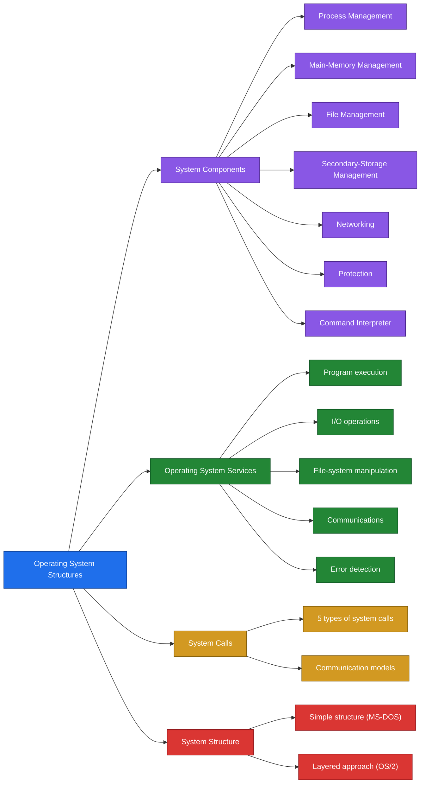

> [!CAUTION]
> ملحوظة: الـ slides بتعدد 8 System Components في الأول (من ضمنهم I/O System Management)، لكن مفيش slide خاصة بيه. الشرح التفصيلي موجود للـ 7 الباقيين بس.

---

## 2. Key Concepts

### System Components

| Term | Definition | الشرح |
|---|---|---|
| Process | A program in execution | البرنامج وهو شغال |
| Main memory | A large array of bytes, each with its own address | مصفوفة bytes كل واحد ليه address |
| Volatile storage | Loses its contents in the case of system failure | بيفقد الداتا لما النظام يقع |
| File | A collection of related information defined by its creator | مجموعة معلومات مترابطة |
| Secondary storage | Backs up main memory, usually disks | تخزين دائم بيدعم الـ main memory |
| Distributed system | A collection of processors that do not share memory or a clock | processors كل واحد ليه memory خاصة |
| Protection | A mechanism for controlling access by programs or users to system resources | التحكم في مين يوصل لإيه |
| Command interpreter | Reads and executes the control statements | بيقرا الأوامر وينفذها |
| Shell | The name of the command interpreter in UNIX | اسم الـ command interpreter في UNIX |

### Operating System Services

| Term | Definition | الشرح |
|---|---|---|
| Program execution | Load a program into memory and run it | تحميل البرنامج وتشغيله |
| I/O operations | The OS performs I/O because user programs cannot do it directly | الـ OS هو اللي بينفذ الـ I/O |
| File-system manipulation | Read, write, create and delete files | التعامل مع الملفات |
| Communications | Exchange of information between processes | تبادل معلومات بين الـ processes |
| Error detection | Detect errors in hardware, I/O devices or user programs | اكتشاف الأخطاء |

### System Calls

| Term | Definition | الشرح |
|---|---|---|
| System call | The interface between a running program and the OS | الطريقة اللي البرنامج بيطلب بيها من الـ OS |
| Message passing | Processes communicate by sending messages | الـ processes بتتبادل رسايل |
| Shared memory | Processes communicate through a shared region of memory | الـ processes بتتشارك جزء من الـ memory |
| IPC | Inter-process communication | التواصل بين الـ processes |

### System Structure

| Term | Definition | الشرح |
|---|---|---|
| Simple structure | One of the two OS design structures, example MS-DOS | أحد تصميمين للـ OS، ومثاله MS-DOS |
| Layered approach | The OS is divided into layers, each built on top of lower layers | الـ OS مقسوم لطبقات |
| Layer 0 | The hardware | أول طبقة |
| Layer N | The user interface | آخر طبقة |
| Modularity | Each layer uses only the services of lower-level layers | كل طبقة بتستخدم اللي تحتها بس |

---

## 3. Detailed Explanation

### 3.1 System Components

الـ OS مش حاجة واحدة، هو مجموعة مسؤوليات. الـ slides بتعدد 8 components.

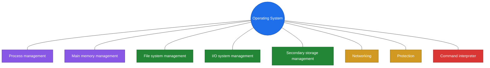

**Process Management**

- A process is a program in execution.
- A process needs resources to accomplish its task: CPU time, memory, files and I/O devices.
- The OS is responsible for:
  - Process creation and deletion.
  - Process suspension and resumption.
  - Process communication.

الـ program مجرد ملف على الـ disk، لما يشتغل بيبقى process. والـ process محتاجة resources والـ OS هو اللي بيوفرها وبيدير حياتها.

**Main-Memory Management**

- Memory is a large array of bytes, each with its own address.
- It is a repository of quickly accessible data shared by the CPU and I/O devices.
- Main memory is a volatile storage device. It loses its contents in the case of system failure.
- The OS is responsible for:
  - Keeping track of which parts of memory are currently being used and by whom.
  - Deciding which processes to load when memory space becomes available.
  - Allocating and de-allocating memory space as needed.

**File Management**

- A file is a collection of related information defined by its creator. Commonly, files represent programs and data.
- The OS is responsible for:
  - File creation and deletion.
  - Directory creation and deletion.
  - Support of primitives for manipulating files and directories.
  - Mapping files onto secondary storage.
  - File backup on stable (non-volatile) storage media.

**Secondary-Storage Management**

- Main memory is volatile and too small to accommodate all data and programs permanently, so the system must provide secondary storage to back up main memory.
- Most modern computer systems use disks as the principal on-line storage medium, for both programs and data.
- The OS is responsible for:
  - Free space management.
  - Storage allocation.
  - Disk scheduling.

**Networking (Distributed Systems)**

- A distributed system is a collection of processors that do not share memory or a clock. Each processor has its own local memory.
- The processors are connected through a communication network.
- Communication takes place using a protocol.
- A distributed system provides user access to various system resources.
- Access to a shared resource allows: computation speed-up, increased data availability, enhanced reliability.

**Protection System**

- Protection refers to a mechanism for controlling access by programs or users to system resources.
- The protection mechanism must:
  - Distinguish between authorized and unauthorized usage.
  - Specify the controls to be imposed.

**Command-Interpreter System**

- Many commands are given to the OS by control statements which deal with: process creation and management, I/O handling, secondary-storage management, main-memory management, file-system access, protection, networking.
- The program that reads and interprets control statements is called the command-line interpreter, or the shell in UNIX.
- Its function is to get and execute the next command statement.

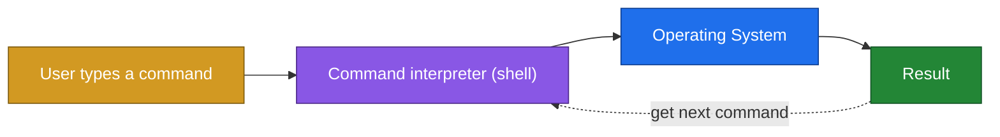

الجدول ده بيلخص كل component والـ OS مسؤول عنه بإيه.

| Component | OS responsibilities |
|---|---|
| Process management | Creation and deletion, suspension and resumption, communication |
| Main-memory management | Track used parts and who uses them, decide which processes to load, allocate and de-allocate |
| File management | Create and delete files and directories, file primitives, map files to secondary storage, backup |
| Secondary-storage management | Free space management, storage allocation, disk scheduling |
| Networking | Provide access to shared resources over a communication network using a protocol |
| Protection | Distinguish authorized from unauthorized usage, specify controls |
| Command interpreter | Read and execute the next command statement |

> [!CAUTION]
> ملحوظة: الـ main memory volatile، علشان كده محتاجين secondary storage. الاتنين ظاهرين كـ components منفصلة في الـ slides.

### 3.2 Operating System Services

- Program execution: the system capability to load a program into memory and to run it.
- I/O operations: user programs cannot execute I/O operations directly, so the OS must provide some means to perform I/O.
- File-system manipulation: the program capability to read, write, create and delete files.
- Communications: exchange of information between processes executing either on the same computer or on different systems tied together by a network. Implemented via shared memory or message passing.
- Error detection: ensure correct computing by detecting errors in the CPU and memory hardware, in I/O devices, or in user programs.

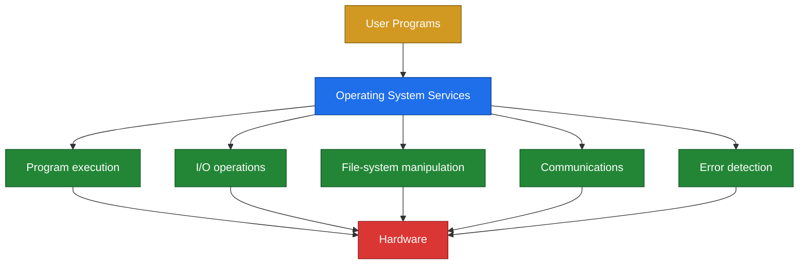

> [!CAUTION]
> ملحوظة: البرنامج مينفعش ينفذ I/O بنفسه، لازم يعدي على الـ OS. ده السبب إن الـ system calls موجودة.

### 3.3 System Calls

- System calls provide the interface between a running program and the operating system.
- Generally available as assembly-language instructions.
- Languages defined to replace assembly language for systems programming allow system calls to be made directly, for example C and C++.

**Copy Program Example**

The slide shows a program that copies one file to another using system calls:

1. Variable initialization
2. open ( file1 )
3. create ( file2 )
4. read ( file1 )
5. write ( file2 )
6. close ( file1 )
7. close ( file2 )

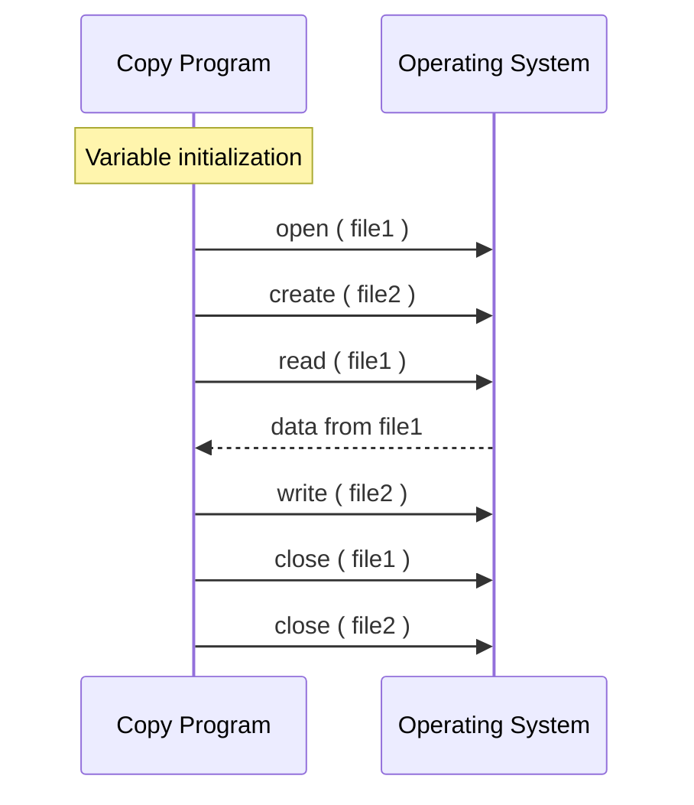

الـ copy program لوحده مش بيلمس الـ disk. كل خطوة بتطلب من الـ OS عن طريق system call.

**Types of System Calls**

| Process Control | File Management | Device Management | Information Maintenance | Communications (IPC) |
|---|---|---|---|---|
| load, execute | create file, delete file | request, release | get time, set time | create channel, delete channel |
| end, abort | open, close | attach, detach | get system data, set system data | send message, receive message |
| create, terminate | read / write, reposition | read, write | get attributes, set attributes | transfer status |
| get attributes, set attributes | get attributes, set attributes | get attributes, set attributes | | attach / detach remote device |
| wait time, event, signal | | | | |
| allocate memory, free memory | | | | |

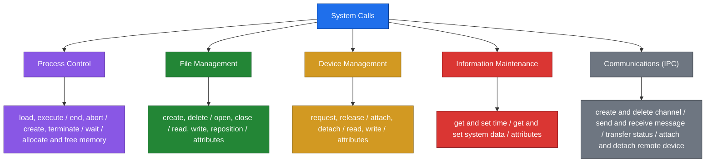

**Communication Models**

There are two models for communication between processes: message passing and shared memory.

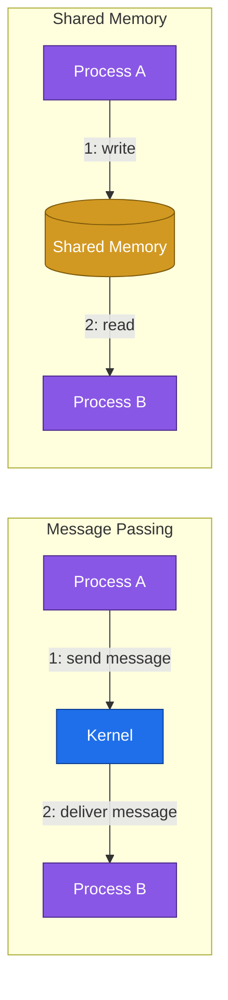

الرسمة في الـ slides بتوضح إن في الـ message passing الرسالة بتعدي على الـ kernel من process لـ process، وفي الـ shared memory فيه منطقة في النص بين الـ process A والـ process B وهما بيستخدموها.

### 3.4 System Structure

The OS system design structure is one of two types: simple structure or layered approach.

**MS-DOS Structure (Simple Structure)**

الرسمة في الـ slides بتوضح 4 مستويات، وإن البرنامج ممكن يوصل لأكتر من مستوى مباشرة.

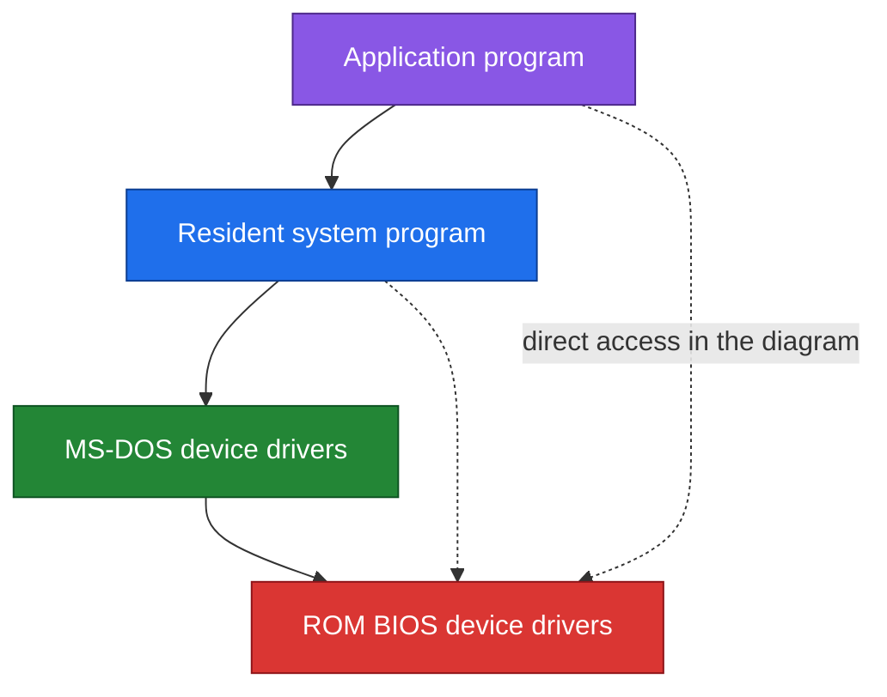

**Layered Approach**

- The OS is divided into a number of layers (levels), each built on top of lower layers.
- The bottom layer (layer 0) is the hardware. The highest layer (layer N) is the user interface.
- With modularity, layers are selected such that each uses the functions (operations) and services of only lower-level layers.
- Advantages: modularity, debugging, modification.
- Disadvantage: layering overhead to the system call.

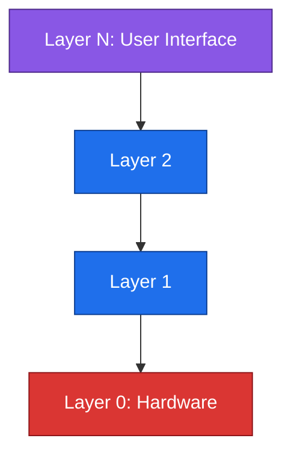

> [!CAUTION]
> ملحوظة: كل layer بتستخدم الـ layers اللي تحتها بس. وعيبها إن الـ system call بتعدي على كذا layer فبتتأخر شوية، وده الـ layering overhead.

**OS/2 Layer Structure**

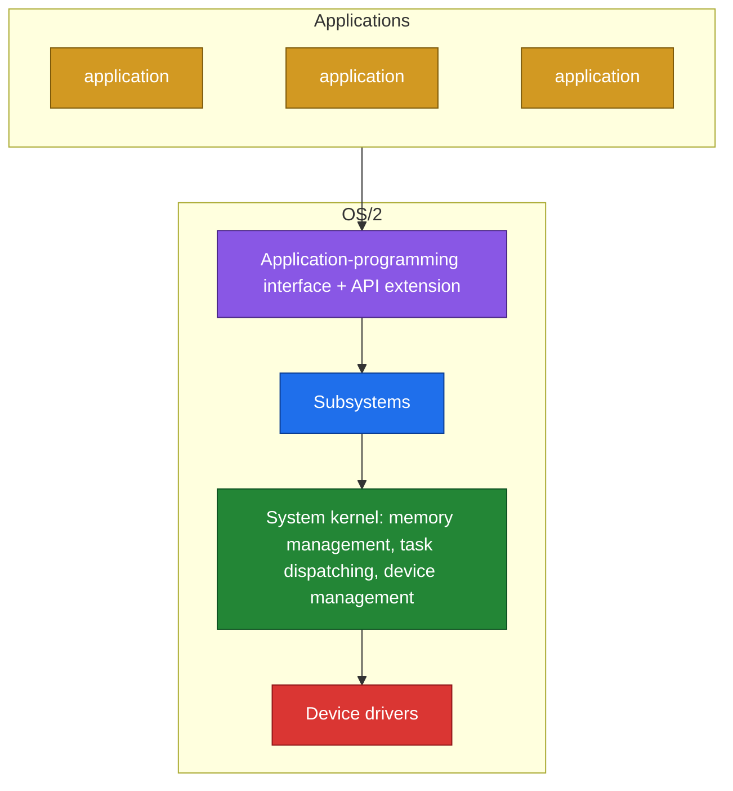

---

## 4. Examples and Diagrams

### From a Program to the Hardware

الرسمة دي توضيح عام لمسار طلب I/O بيبدأ من البرنامج.

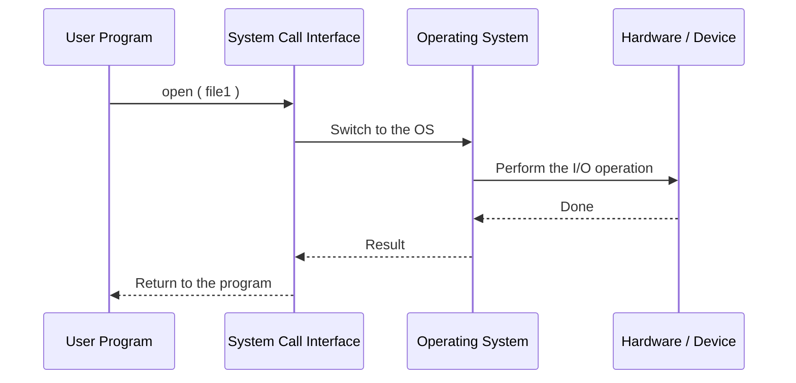

### The Shell and the System Components

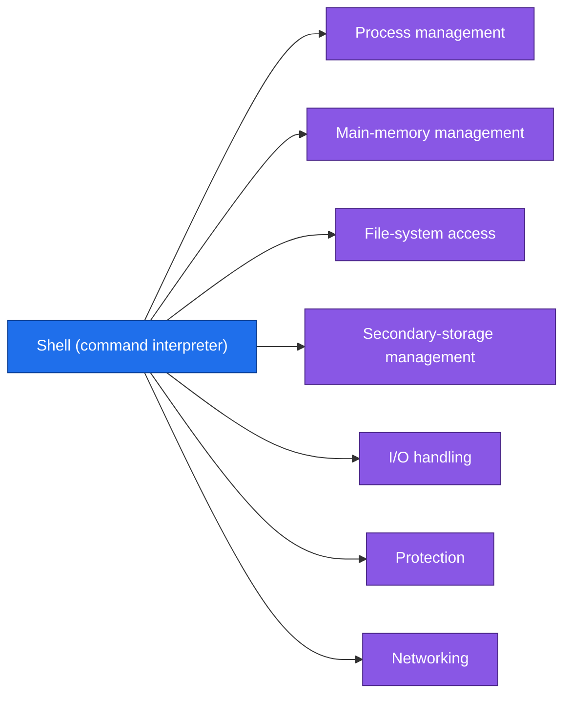

### Examples

| Concept | Example |
|---|---|
| Process | A web browser that is currently running |
| Volatile storage | Main memory after a power failure |
| Secondary storage | A disk holding programs and data |
| Distributed system resource access | Using a file that sits on another machine on the network |
| Command interpreter | The shell in UNIX |
| I/O through the OS | A program asking the OS to write to a file |
| System call from a language | Calling open or read in C |
| Process control call | execute, end, abort |
| File management call | open, close, read, write |
| Device management call | request, release |
| Information maintenance call | get time, set time |
| Communications call | send message, receive message |
| Simple structure | MS-DOS |
| Layered structure | OS/2 |

---

## 5. Important Comparisons

### Message Passing vs Shared Memory

| | Message Passing | Shared Memory |
|---|---|---|
| Idea | Processes exchange messages | Processes use a shared region of memory |
| Path in the slide diagram | Message goes through the kernel | A shared memory area between process A and process B |
| Used for | Communications between processes, on the same computer or on different systems | Communications between processes, on the same computer or on different systems |

### Simple Structure vs Layered Approach

| | Simple Structure (MS-DOS) | Layered Approach (OS/2) |
|---|---|---|
| Organization | A few levels, a program can reach lower levels directly in the diagram | Layers, each built on lower layers |
| Rule | No strict rule in the slides | Each layer uses only lower-level layers |
| Bottom | ROM BIOS device drivers | Layer 0: hardware |
| Top | Application program | Layer N: user interface |
| Advantages | Not listed in the slides | Modularity, debugging, modification |
| Disadvantage | Not listed in the slides | Layering overhead to the system call |

### Main Memory vs Secondary Storage

| | Main Memory | Secondary Storage |
|---|---|---|
| Volatility | Volatile, loses its contents on system failure | Non-volatile |
| Size | Too small to hold everything permanently | Backs up main memory |
| Typical device | Array of bytes with addresses | Disks |
| OS responsibilities | Track usage, decide what to load, allocate and de-allocate | Free space management, storage allocation, disk scheduling |

### System Call Types

| Type | Main calls |
|---|---|
| Process Control | load, execute, end, abort, create, terminate, wait, allocate memory, free memory |
| File Management | create file, delete file, open, close, read, write, reposition |
| Device Management | request, release, attach, detach, read, write |
| Information Maintenance | get time, set time, get system data, set system data |
| Communications (IPC) | create channel, delete channel, send message, receive message, transfer status |

### Services vs Components

| | OS Services | System Components |
|---|---|---|
| Point of view | What the OS offers to programs and users | What the OS manages internally |
| Count in the slides | 5 | 8 |
| Examples | Program execution, I/O operations, error detection | Process management, protection, networking |

---

## 6. Quick Revision

| Term | In one line |
|---|---|
| Process | A program in execution |
| Main memory | Large array of bytes, volatile |
| File | Collection of related information defined by its creator |
| Secondary storage | Disks that back up main memory |
| Distributed system | Processors that do not share memory or a clock |
| Protection | Controls access to system resources |
| Shell | UNIX name for the command interpreter |
| System call | Interface between a running program and the OS |
| Message passing | IPC by sending messages |
| Shared memory | IPC through a shared region |
| Layered approach | Layer 0 is hardware, layer N is the user interface |
| Layering overhead | The disadvantage of layers on system calls |

| Topic | Count | Items |
|---|:---:|---|
| System components | 8 | Process, Main memory, File system, I/O system, Secondary storage, Networking, Protection, Command interpreter |
| OS services | 5 | Program execution, I/O operations, File-system manipulation, Communications, Error detection |
| System call types | 5 | Process control, File management, Device management, Information maintenance, Communications |
| Communication models | 2 | Message passing, Shared memory |
| System design structures | 2 | Simple structure, Layered approach |
| Process management activities | 3 | Creation and deletion, Suspension and resumption, Communication |
| Memory management activities | 3 | Track usage, Decide which processes to load, Allocate and de-allocate |
| Disk management activities | 3 | Free space management, Storage allocation, Disk scheduling |
| Layered approach advantages | 3 | Modularity, Debugging, Modification |
| Distributed access benefits | 3 | Computation speed-up, Increased data availability, Enhanced reliability |

**Copy program order:** variable initialization, open file1, create file2, read file1, write file2, close file1, close file2.

**Interview answer: What is a system call?**

A system call is the interface between a running program and the operating system. User programs cannot execute I/O operations directly, so when a program needs a service such as opening a file or reading from a device, it makes a system call and the OS performs the operation for it. System calls fall into five types: process control, file management, device management, information maintenance, and communications.

---

## 7. Questions to Test Myself

### Multiple Choice

**Q1. What is a process?**

- A. A file stored on disk
- B. A program in execution ✔
- C. A device controller
- D. A part of the kernel

**Q2. Main memory is:**

- A. Non-volatile
- B. Volatile ✔
- C. Read only
- D. A secondary storage device

**Q3. What is the shell in UNIX?**

- A. The kernel
- B. The command interpreter ✔
- C. A device driver
- D. A system call

**Q4. Which of these is an OS service?**

- A. Layering
- B. Error detection ✔
- C. The ROM BIOS
- D. The shell prompt only

**Q5. Why does the OS perform I/O operations for user programs?**

- A. User programs are too slow
- B. User programs cannot execute I/O operations directly ✔
- C. The disk is volatile
- D. The CPU has no I/O instructions

**Q6. Which system call type includes `create channel` and `send message`?**

- A. Process control
- B. File management
- C. Communications (IPC) ✔
- D. Information maintenance

**Q7. Which system call type includes `get time` and `set time`?**

- A. Device management
- B. Information maintenance ✔
- C. File management
- D. Process control

**Q8. In the layered approach, what is layer 0?**

- A. The user interface
- B. The kernel
- C. The hardware ✔
- D. The shell

**Q9. What is the disadvantage of the layered approach?**

- A. Difficult debugging
- B. No modularity
- C. Layering overhead to the system call ✔
- D. It cannot use hardware

**Q10. In which communication model do processes share a region of memory?**

- A. Message passing
- B. Shared memory ✔
- C. Layered approach
- D. Simple structure

### True / False

1. A distributed system is a collection of processors that share memory and a clock.
   **False.** They do not share memory or a clock.
2. Communication in a distributed system takes place using a protocol.
   **True.**
3. Secondary storage is needed because main memory is volatile and too small.
   **True.**
4. In the layered approach each layer can use the services of any other layer.
   **False.** Each layer uses only lower-level layers.
5. System calls can be made directly from languages like C and C++.
   **True.**
6. A file is a collection of related information defined by its creator.
   **True.**
7. MS-DOS is the example of the layered approach in the slides.
   **False.** MS-DOS is the simple structure example, OS/2 is the layered one.

### Essay Questions

**Q11. List the system components of an operating system.**

Process management, main-memory management, file system management, I/O system management, secondary-storage management, networking, protection, and the command interpreter.

**Q12. What are the OS responsibilities in process management?**

Process creation and deletion, process suspension and resumption, and process communication.

**Q13. What are the OS responsibilities in main-memory management?**

Keep track of which parts of memory are currently being used and by whom, decide which processes to load when memory space becomes available, and allocate and de-allocate memory space as needed.

**Q14. What are the OS responsibilities in file management?**

File creation and deletion, directory creation and deletion, support of primitives for manipulating files and directories, mapping files onto secondary storage, and file backup on stable storage media.

**Q15. Why do we need secondary storage, and what does the OS do to manage it?**

Main memory is volatile and too small to hold all data and programs permanently, so the system provides secondary storage to back it up. The OS handles free space management, storage allocation and disk scheduling.

**Q16. What are the benefits of access to a shared resource in a distributed system?**

Computation speed-up, increased data availability, and enhanced reliability.

**Q17. What is the command interpreter, and what does it do?**

It is the program that reads and interprets control statements, called the command-line interpreter or the shell in UNIX. Its function is to get and execute the next command statement.

**Q18. List the operating system services.**

Program execution, I/O operations, file-system manipulation, communications, and error detection.

**Q19. What is a system call, and what are its types?**

A system call provides the interface between a running program and the operating system. Its types are process control, file management, device management, information maintenance, and communications.

**Q20. Compare message passing and shared memory.**

In message passing the processes exchange messages and the message goes through the kernel. In shared memory the processes use a shared region of memory between them.

**Q21. Explain the layered approach with its advantages and disadvantage.**

The OS is divided into layers, each built on top of lower layers. Layer 0 is the hardware and layer N is the user interface, and each layer uses only the services of lower-level layers. Advantages: modularity, debugging, modification. Disadvantage: layering overhead to the system call.

**Q22. Write the sequence of system calls in the copy program example.**

Variable initialization, open file1, create file2, read file1, write file2, close file1, close file2.
