# 04-Processes

## 1. Overview

الشابتر ده عن الـ process، يعني البرنامج وهو شغال. هنفهم الـ process فيه إيه، وبيمر بحالات إيه، والـ OS بيرتب مين ياخد الـ CPU إزاي، وإزاي الـ processes بتتعمل وبتخلص، وإزاي بتتعاون مع بعض.

| Topic | بيتكلم عن إيه |
|---|---|
| Process Concept | تعريف الـ process ومحتوياته وحالاته والـ PCB |
| Process Scheduling | الـ queues والـ schedulers والـ context switch |
| Operations on Processes | إنشاء الـ process وإنهاؤها |
| Cooperating Processes | الـ processes المستقلة والمتعاونة |
| Inter-process Communication | Message Passing و Shared Memory |

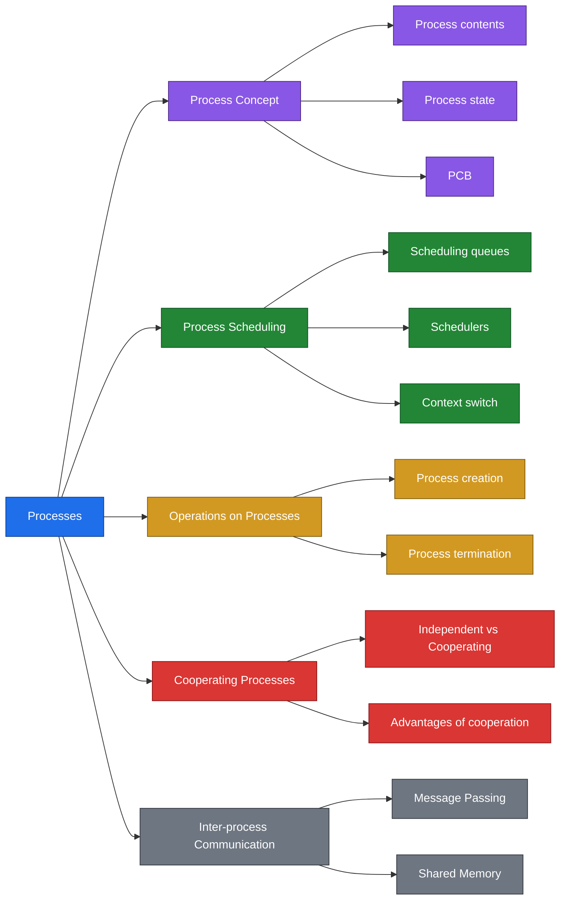

> [!CAUTION]
> ملحوظة: قسم الـ Inter-process Communication في الـ slides بيذكر بس الاسمين Message Passing و Shared Memory من غير شرح. التفاصيل والرسمة كانت في Chapter 3.

---

## 2. Key Concepts

### Process Concept

| Term | Definition | الشرح |
|---|---|---|
| Process | A program in execution, progressing in sequential fashion | البرنامج وهو شغال |
| Text section | The program instructions | كود البرنامج نفسه |
| Program counter | The next instruction | بيشاور على الأمر الجاي |
| Stack | Local variables, return addresses, method parameters | مكان البيانات المؤقتة للـ functions |
| Data section | Global variables | المتغيرات العامة |
| Process state | new, running, waiting, ready, terminated | حالة الـ process الحالية |
| PCB | Information associated with each process | ملف بيانات الـ process عند الـ OS |

### Process Scheduling

| Term | Definition | الشرح |
|---|---|---|
| Job queue | The set of all processes in the system | كل الـ processes اللي في النظام |
| Ready queue | Processes in main memory that are ready and waiting to execute | الجاهزة وبتستنى الـ CPU |
| Device queue | Processes waiting for an I/O device | بتستنى device |
| Long-term scheduler | Selects which processes should be brought into the ready queue | بيختار مين يدخل الـ ready queue |
| Short-term scheduler | Selects which process executes next and allocates the CPU | بيختار مين ياخد الـ CPU |
| I/O-bound process | Spends more time doing I/O than computations | وقته أكتر في الـ I/O |
| CPU-bound process | Spends more time doing computations | وقته أكتر في الحسابات |
| Context switch | Saving the state of the old process and loading the saved state of the new one | تبديل الـ CPU من process للتانية |

### Operations on Processes

| Term | Definition | الشرح |
|---|---|---|
| Process creation | A parent process creates children processes | الـ parent بيعمل children |
| Tree of processes | Children create other processes | شجرة من الـ processes |
| exit | The process executes its last statement and asks the OS to delete it | الـ process بتخلص نفسها |
| abort | The parent terminates the execution of a child | الـ parent بيقفل child |
| Cascading termination | The OS does not allow a child to continue if its parent terminates | لو الـ parent خلص الـ children بتتقفل |

### Cooperating Processes and IPC

| Term | Definition | الشرح |
|---|---|---|
| Independent process | Cannot affect or be affected by another process | مبتتأثرش بحد |
| Cooperating process | Can affect or be affected by another process | بتتأثر وبتأثر |
| IPC | Inter-process communication | التواصل بين الـ processes |
| Message Passing | An IPC model | نموذج تواصل بالرسايل |
| Shared Memory | An IPC model | نموذج تواصل بذاكرة مشتركة |

---

## 3. Detailed Explanation

### 3.1 Process Concept

- A process is a program in execution. Process execution must progress in sequential fashion.
- An operating system executes a variety of programs: batch systems and time-shared systems.
- The textbook uses the terms job and process almost interchangeably.

**Process Contents**

| Part | What it holds |
|---|---|
| Text section | Program instructions |
| Program counter | The next instruction |
| Stack | Local variables, return addresses, method parameters |
| Data section | Global variables |

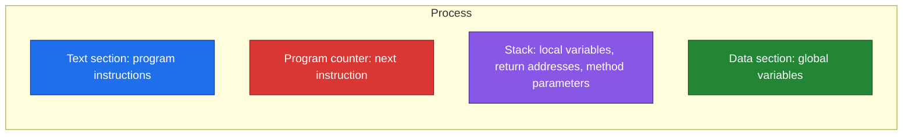

**Process State**

As a process executes, it changes state.

| State | Meaning |
|---|---|
| new | The process is being created |
| running | Instructions are being executed |
| waiting | The process is waiting for some event to occur |
| ready | The process is waiting to be assigned to a processor |
| terminated | The process has finished execution |

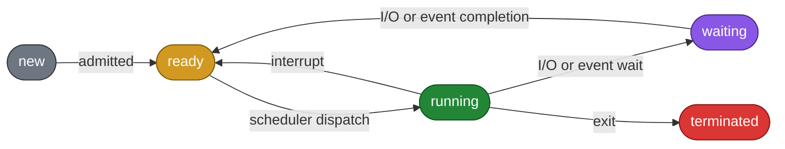

> [!CAUTION]
> ملحوظة: الـ process اللي في حالة waiting لما الـ I/O يخلص مبترجعش running على طول، بترجع ready الأول وتستنى الـ scheduler.

**Process Control Block (PCB)**

- Information associated with each process.
- The PCB contains: process state, program counter, CPU registers, CPU scheduling information, memory-management information, accounting information, I/O status information.
- The PCB diagram in the slides shows: pointer, process state, process number, program counter, CPU registers, memory-management info, I/O status information, accounting information.

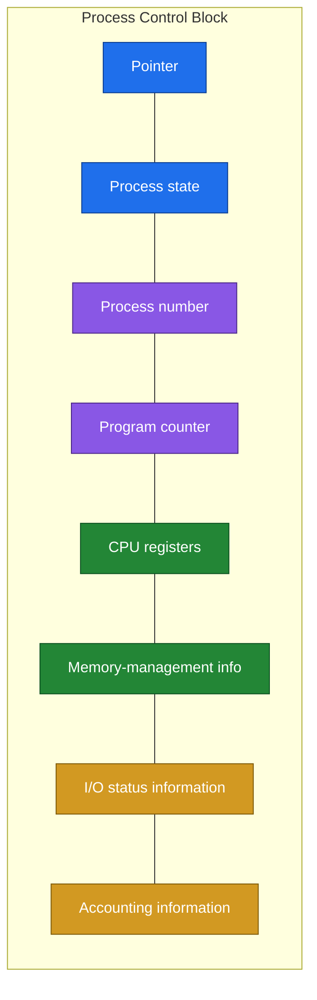

### 3.2 Process Scheduling

- Multi-programming systems: some processes are executing at all times, to maximize CPU utilization.
- Time-sharing systems: switch the CPU among processes frequently, so users can interact with a program while it is executing. Processes virtually run at the same time.

**Process Scheduling Queues**

- Job queue: the set of all processes in the system.
- Ready queue: the set of all processes residing in main memory which are ready and waiting to execute.
- Device queues: the set of processes waiting for an I/O device.
- Processes migrate between the various queues.

**Representation of Process Scheduling**

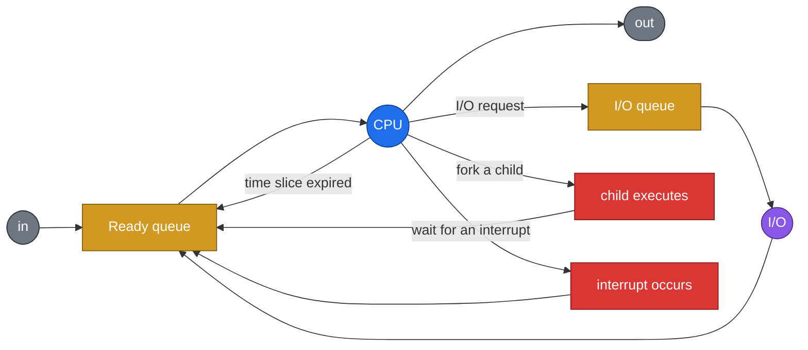

الـ process بتدخل الـ ready queue وتستنى الـ CPU. وهي شغالة ممكن تطلب I/O فتروح الـ I/O queue، أو الـ time slice يخلص فترجع للـ ready queue، أو تعمل child، أو تستنى interrupt. وفي كل الحالات دي بترجع للـ ready queue في الآخر لحد ما تخلص.

**Schedulers**

| Scheduler | Role | Frequency |
|---|---|---|
| Long-term scheduler (job scheduler) | Selects which processes should be brought into the ready queue | Executes infrequently. May be absent in some OS |
| Short-term scheduler (CPU scheduler) | Selects which process should be executed next and allocates the CPU | Executes frequently |

**Addition of Medium-Term Scheduling**

الرسمة في الـ slides بتوضح إن فيه خطوة إضافية: processes متنفذتش بالكامل بتتشال من الـ CPU (swap out) وتتحط في مكان لـ partially executed swapped-out processes، وبعدين ترجع (swap in) للـ ready queue.

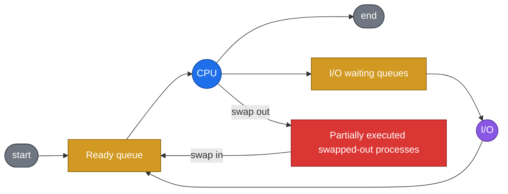

**I/O-bound and CPU-bound processes**

- I/O-bound process: spends more time doing I/O than computations, with many short CPU bursts.
- CPU-bound process: spends more time doing computations, with few very long CPU bursts.

**Context Switch**

- When the CPU switches to another process, the system must save the state of the old process and load the saved state for the new process.
- Context-switch time is overhead: the system does no useful work while switching.
- The time depends on hardware support.

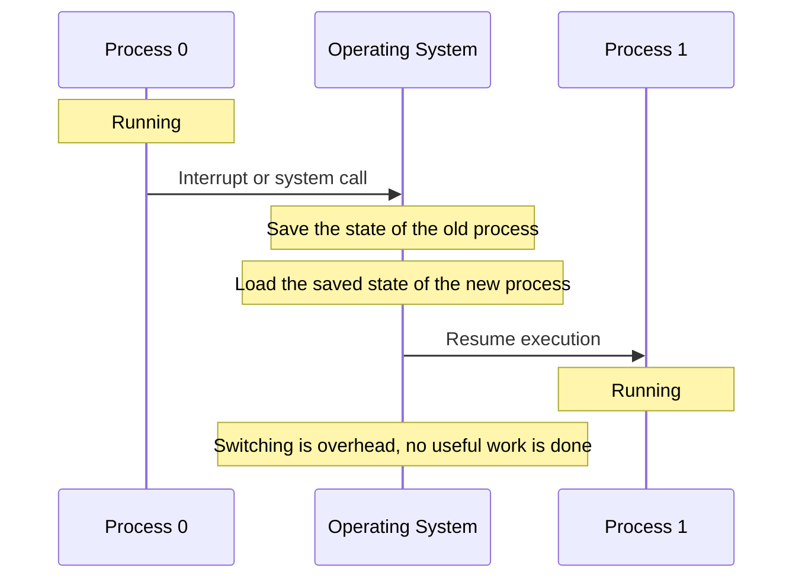

> [!CAUTION]
> ملحوظة: وقت الـ context switch ضايع، لأن النظام مبيعملش أي شغل مفيد وهو بيبدل. وبيتوقف على دعم الـ hardware.

### 3.3 Operations on Processes

The two main operations are process creation and process termination. Each process needs resources: CPU time, memory, files and I/O devices.

**Process Creation**

- A parent process creates children processes, which in turn create other processes, forming a tree of processes.
- Resource sharing:
  - The parent and children share all resources.
  - The children share a subset of the parent's resources.
- Execution:
  - The parent and children execute concurrently.
  - The parent waits until the children terminate.

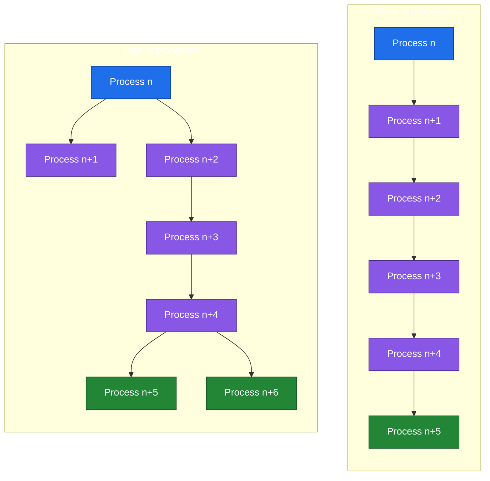

> [!CAUTION]
> ملحوظة: الدواير في رسمة الـ slide فاضية، والأسماء أخدتها من الـ text اللي في نفس الـ slide بترتيبها. ترتيب الأسماء جوه الشجرة تقدير مني من شكل الرسمة.

**Process Termination**

- The process executes its last statement and asks the operating system to delete it (exit).
  - Output data goes from the child to the parent.
  - The process's resources are de-allocated by the operating system.
- The parent may terminate the execution of children processes (abort), when:
  - The child has exceeded its allocated resources.
  - The task assigned to the child is no longer required.
  - The parent is exiting.
- The operating system does not allow a child to continue if its parent terminates. This is cascading termination.

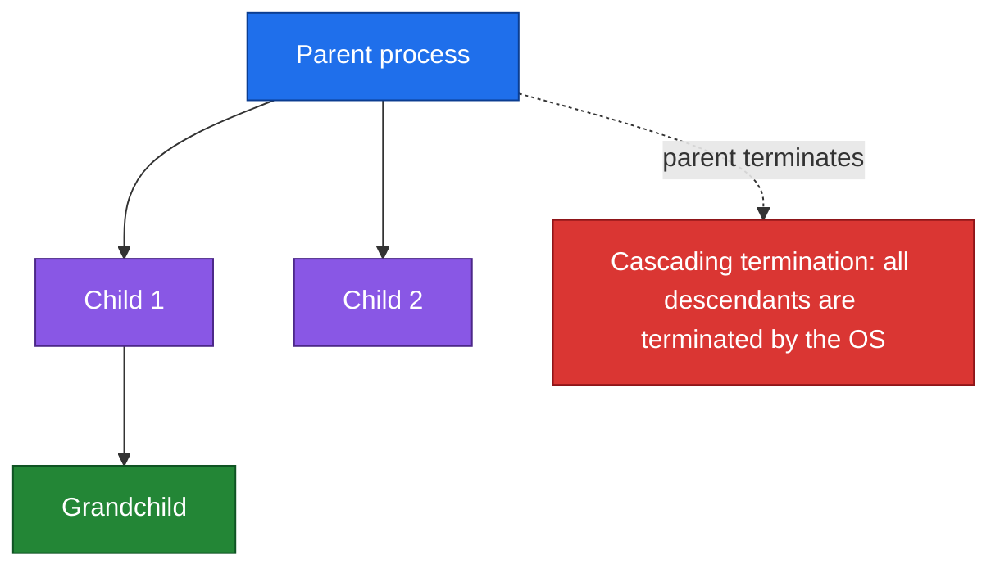

### 3.4 Cooperating Processes

- An independent process cannot affect or be affected by the execution of another process.
- A cooperating process can affect or be affected by the execution of another process.
- Advantages of process cooperation: information sharing, computation speed-up, modularity, convenience.

### 3.5 Inter-process Communication

Two models are listed in the slides: Message Passing and Shared Memory.

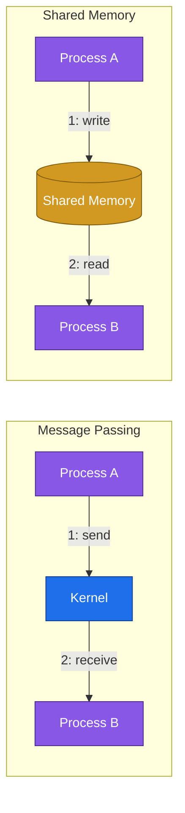

الرسمة دي جاية من Chapter 3 وبنفس الفكرة، لأن الـ slides هنا مفيهاش رسمة للموضوع ده.

---

## 4. Examples and Diagrams

### Life of a Process

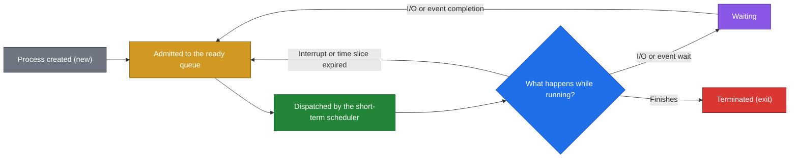

### Parent and Child Lifecycle

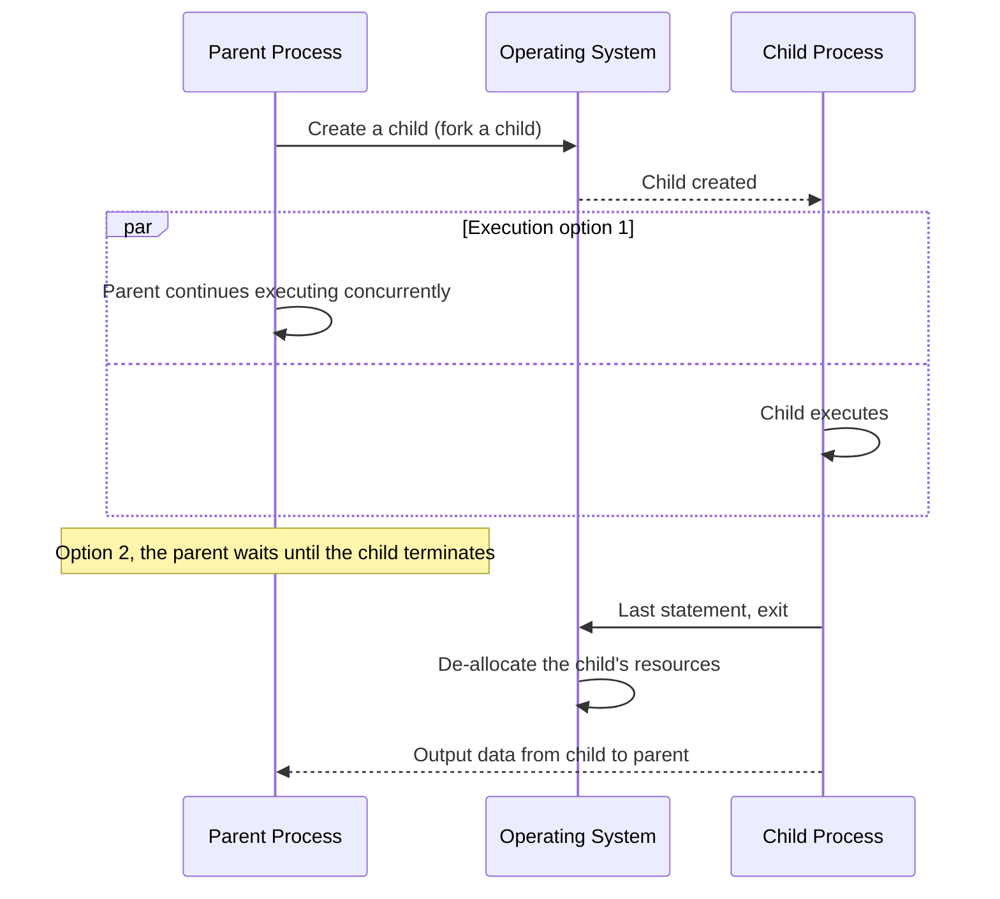

### Examples

| Concept | Example |
|---|---|
| Time-sharing | A user typing in an editor while the CPU switches between processes |
| I/O-bound process | A program that keeps reading from and writing to the disk, with short CPU bursts |
| CPU-bound process | A program doing a heavy calculation, with few very long CPU bursts |
| Waiting state | A process waiting for a disk read to finish |
| Ready state | A process that has finished waiting and is waiting for the CPU |
| Time slice expired | A running process is sent back to the ready queue |
| Fork a child | A parent process creating a new process |
| Abort a child | The parent kills a child that exceeded its allocated resources |
| Cascading termination | The OS terminating all children when their parent exits |
| Cooperating processes | Processes that share information to finish a task faster |

---

## 5. Important Comparisons

### Process States

| State | Meaning | Moves to |
|---|---|---|
| new | Being created | ready (admitted) |
| ready | Waiting for the CPU | running (scheduler dispatch) |
| running | Instructions being executed | ready (interrupt), waiting (I/O or event wait), terminated (exit) |
| waiting | Waiting for an event | ready (I/O or event completion) |
| terminated | Finished execution | None |

### Job Queue vs Ready Queue vs Device Queue

| | Job Queue | Ready Queue | Device Queue |
|---|---|---|---|
| Contains | All processes in the system | Processes in main memory, ready and waiting to execute | Processes waiting for an I/O device |

### Long-term vs Short-term Scheduler

| | Long-term Scheduler | Short-term Scheduler |
|---|---|---|
| Also called | Job scheduler | CPU scheduler |
| Selects | Which processes are brought into the ready queue | Which process executes next |
| Allocates the CPU | No | Yes |
| Frequency | Infrequently | Frequently |
| May be absent | Yes, in some OS | Not stated in the slides |

### I/O-bound vs CPU-bound Process

| | I/O-bound | CPU-bound |
|---|---|---|
| Spends more time on | I/O | Computations |
| CPU bursts | Many short bursts | Few very long bursts |

### Multi-programming vs Time-Sharing (Scheduling)

| | Multi-programming | Time-Sharing |
|---|---|---|
| Goal | Maximize CPU utilization | Let users interact with a running program |
| Behavior | Some processes executing at all times | Switch the CPU among processes frequently |
| Effect | CPU stays busy | Processes virtually run at the same time |

### Parent and Child: Resource Sharing and Execution

| | Option 1 | Option 2 |
|---|---|---|
| Resource sharing | Parent and children share all resources | Children share a subset of the parent's resources |
| Execution | Parent and children execute concurrently | Parent waits until the children terminate |

### Independent vs Cooperating Process

| | Independent | Cooperating |
|---|---|---|
| Affects other processes | No | Yes |
| Affected by other processes | No | Yes |
| Advantages | Not listed in the slides | Information sharing, computation speed-up, modularity, convenience |

### Message Passing vs Shared Memory

| | Message Passing | Shared Memory |
|---|---|---|
| Idea | Processes exchange messages through the kernel | Processes use a shared region of memory |
| Listed in this deck | Name only | Name only |

---

## 6. Quick Revision

| Term | In one line |
|---|---|
| Process | A program in execution |
| Text section | Program instructions |
| Stack | Local variables, return addresses, method parameters |
| Data section | Global variables |
| PCB | Information associated with each process |
| Ready queue | Processes in memory ready to execute |
| Long-term scheduler | Chooses which processes enter the ready queue, runs infrequently |
| Short-term scheduler | Chooses the next process and allocates the CPU, runs frequently |
| Context switch | Save the old state, load the new state, pure overhead |
| exit | The process finishes and asks the OS to delete it |
| abort | The parent terminates a child |
| Cascading termination | No child continues if the parent terminates |
| Cooperating process | Affects or is affected by other processes |

| Topic | Count | Items |
|---|:---:|---|
| Process states | 5 | new, running, waiting, ready, terminated |
| Process contents | 4 | Text section, Program counter, Stack, Data section |
| PCB fields in the list | 7 | State, Program counter, CPU registers, CPU scheduling info, Memory-management info, Accounting info, I/O status info |
| Scheduling queues | 3 | Job, Ready, Device |
| Schedulers | 3 | Long-term, Short-term, Medium-term |
| Process resources | 4 | CPU time, Memory, Files, I/O devices |
| Reasons for a parent to abort a child | 3 | Exceeded resources, Task no longer required, Parent exiting |
| Advantages of cooperation | 4 | Information sharing, Computation speed-up, Modularity, Convenience |
| IPC models | 2 | Message Passing, Shared Memory |

**State transitions:** new to ready (admitted), ready to running (scheduler dispatch), running to ready (interrupt), running to waiting (I/O or event wait), waiting to ready (I/O or event completion), running to terminated (exit).

**Interview answer: What is a process, and what states does it go through?**

A process is a program in execution. It has a text section, a program counter, a stack and a data section. During its life it moves between five states: new, ready, running, waiting and terminated. The scheduler dispatches a ready process to the CPU, and when the process waits for I/O it goes to the waiting state and returns to ready when the I/O completes. The operating system keeps all the information about each process in its process control block.

**Interview answer: What is a context switch?**

When the CPU switches from one process to another, the system saves the state of the old process and loads the saved state of the new one. It is pure overhead, because the system does no useful work during the switch, and its duration depends on hardware support.

---

## 7. Questions to Test Myself

### Multiple Choice

**Q1. What is a process?**

- A. A file on the disk
- B. A program in execution ✔
- C. A device controller
- D. A queue of jobs

**Q2. Which state means the process is waiting to be assigned to a processor?**

- A. new
- B. waiting
- C. ready ✔
- D. terminated

**Q3. A running process requests I/O. Which state does it go to?**

- A. ready
- B. waiting ✔
- C. new
- D. terminated

**Q4. What does the stack hold?**

- A. Global variables
- B. Program instructions
- C. Local variables, return addresses and method parameters ✔
- D. The accounting information

**Q5. Which queue holds the processes waiting for an I/O device?**

- A. Job queue
- B. Ready queue
- C. Device queue ✔
- D. Long-term queue

**Q6. Which scheduler executes frequently and allocates the CPU?**

- A. Long-term scheduler
- B. Short-term scheduler ✔
- C. Job scheduler
- D. Medium-term only

**Q7. A process with many short CPU bursts that spends more time on I/O is:**

- A. CPU-bound
- B. I/O-bound ✔
- C. Independent
- D. Terminated

**Q8. What is true about the context switch?**

- A. It is useful work done by the system
- B. It is overhead with no useful work ✔
- C. It does not depend on hardware
- D. It happens only at termination

**Q9. What does cascading termination mean?**

- A. A child terminates its parent
- B. The OS does not allow a child to continue if its parent terminates ✔
- C. All processes terminate together at boot
- D. A process terminates itself after exit

**Q10. Which one is an advantage of process cooperation?**

- A. Isolation from all other processes
- B. Computation speed-up ✔
- C. No need for communication
- D. Reduced memory

### True / False

1. A process in the waiting state returns directly to running when its I/O completes.
   **False.** It goes to ready first.
2. The long-term scheduler executes more frequently than the short-term scheduler.
   **False.** The long-term scheduler executes infrequently.
3. The ready queue contains the processes in main memory that are ready and waiting to execute.
   **True.**
4. A CPU-bound process has many short CPU bursts.
   **False.** It has few very long CPU bursts.
5. The parent and children may execute concurrently.
   **True.**
6. An independent process can be affected by another process.
   **False.**
7. When a process exits, its resources are de-allocated by the OS.
   **True.**

### Essay Questions

**Q11. What is a process, and what are its contents?**

A process is a program in execution. Its contents are the text section (program instructions), the program counter (next instruction), the stack (local variables, return addresses, method parameters), and the data section (global variables).

**Q12. Explain the five process states.**

New: the process is being created. Running: instructions are being executed. Waiting: the process is waiting for some event to occur. Ready: the process is waiting to be assigned to a processor. Terminated: the process has finished execution.

**Q13. What is the Process Control Block, and what does it contain?**

It is the information associated with each process. It contains the process state, program counter, CPU registers, CPU scheduling information, memory-management information, accounting information, and I/O status information.

**Q14. Describe the three scheduling queues.**

The job queue holds all processes in the system. The ready queue holds the processes in main memory that are ready and waiting to execute. The device queues hold the processes waiting for an I/O device.

**Q15. Compare the long-term and short-term schedulers.**

The long-term scheduler (job scheduler) selects which processes should be brought into the ready queue, executes infrequently, and may be absent in some OS. The short-term scheduler (CPU scheduler) selects which process should be executed next and allocates the CPU, and executes frequently.

**Q16. Differentiate between I/O-bound and CPU-bound processes.**

An I/O-bound process spends more time doing I/O than computations and has many short CPU bursts. A CPU-bound process spends more time doing computations and has few very long CPU bursts.

**Q17. What is a context switch, and why is it overhead?**

When the CPU switches to another process, the system saves the state of the old process and loads the saved state of the new one. It is overhead because the system does no useful work while switching, and its time depends on hardware support.

**Q18. Explain process creation, including resource sharing and execution options.**

A parent process creates children processes, which in turn create other processes, forming a tree. For resource sharing, the parent and children share all resources, or the children share a subset of the parent's resources. For execution, the parent and children execute concurrently, or the parent waits until the children terminate.

**Q19. Explain process termination and when a parent may abort a child.**

A process executes its last statement and asks the OS to delete it (exit). Output data goes from the child to the parent and the OS de-allocates its resources. A parent may abort a child when the child has exceeded its allocated resources, when the task assigned to the child is no longer required, or when the parent is exiting.

**Q20. What is cascading termination?**

The operating system does not allow a child to continue if its parent terminates, so all the children are terminated too.

**Q21. Differentiate between independent and cooperating processes, and list the advantages of cooperation.**

An independent process cannot affect or be affected by the execution of another process, while a cooperating process can. The advantages of cooperation are information sharing, computation speed-up, modularity, and convenience.

**Q22. What are the two models of inter-process communication?**

Message Passing and Shared Memory.
